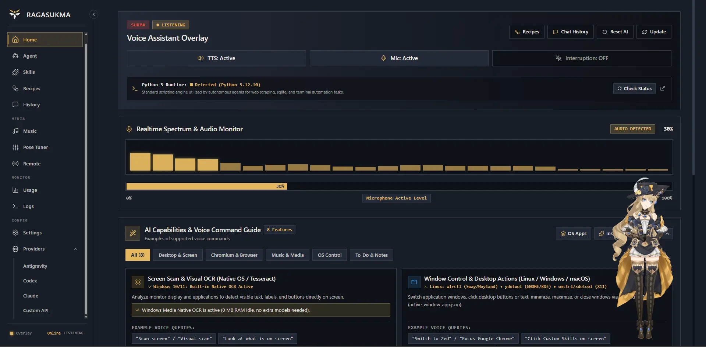
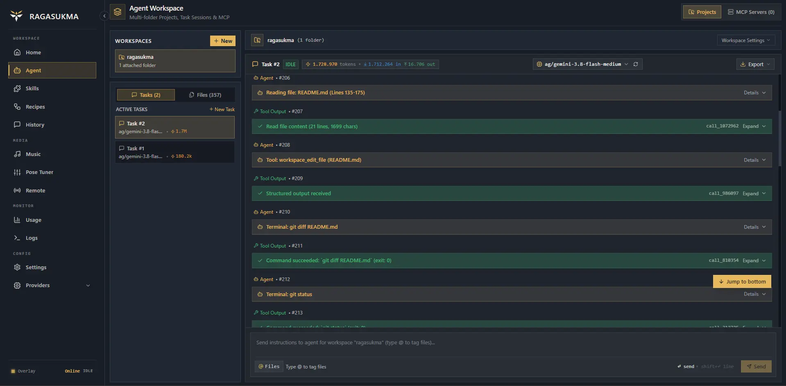
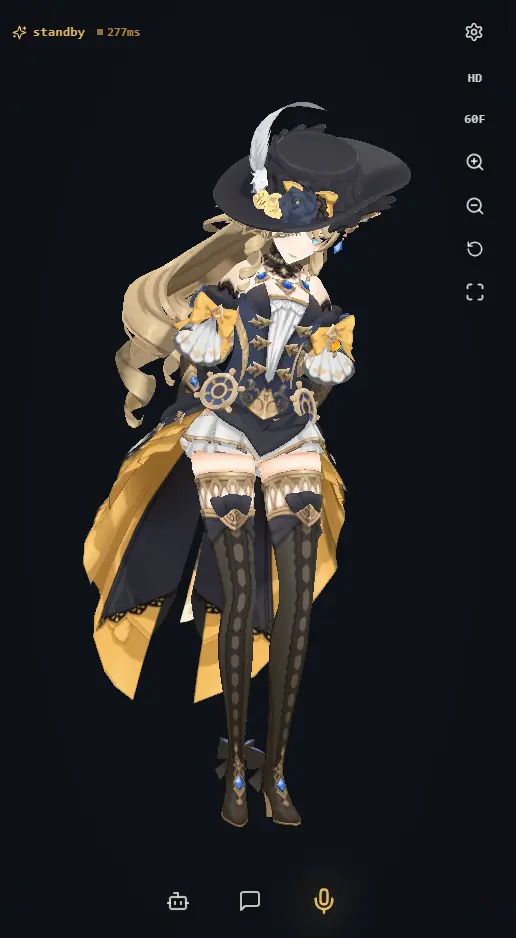
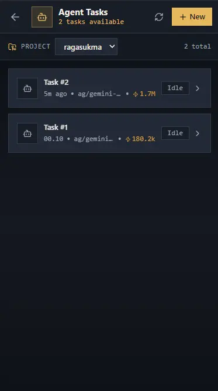
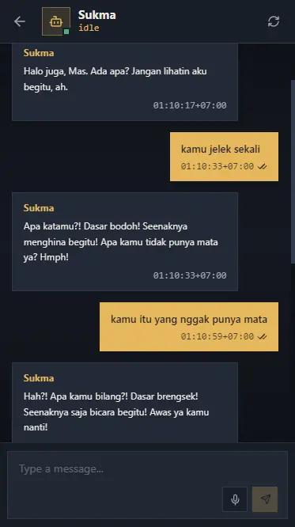

  

  # Ragasukma
  **Native Desktop AI Voice Companion & Autonomous Agent**

  
  
  
  

  

    A high-performance desktop AI companion and autonomous agent built in native Rust. Features an interactive transparent 3D avatar overlay, instant zero-shot voice cloning, hands-free browser automation, background music streaming, an autonomous coding engine, a local OpenAI-compatible API router, and encrypted remote mobile access via Cloudflare Tunnel.
  

   
  

---

## Previews & Showcase

### Agent Harness Workspace

### Mobile Web Companion (Remote Access)
| Mobile 3D Avatar Companion | Remote Pairing & Controls | AI Agent |
| :---: | :---: | :---: |
|  |  |  |

---

## Overview

**Ragasukma** merges the emotional presence of an interactive 3D virtual companion with the raw productivity of an autonomous software engineering agent and desktop assistant:

- **As a Companion**: Floats transparently on your desktop or accompanies you on your mobile phone, featuring lifelike 3D physics, real-time voice synthesis in 31 languages, instant voice cloning, and responsive emotional expressions.
- **As an Assistant**: Listens, speaks, executes operating system commands, controls browser tabs, plays music from YouTube or local storage, and tracks your daily to-do tasks hands-free.
- **As an Autonomous Agent**: Inspects codebases, executes shell tools, performs multi-file code modifications with automatic rollback safety, and serves as a local OpenAI-compatible AI backend for tools like Cursor, VS Code, and Zed.

---

## Key Features

### 1. Ultra-Fast Voice Engine & Zero-Shot Voice Cloning
- **Instant Local Neural Voices (Supertonic)**:
  - Generates speech directly on your local CPU using lightweight ONNX neural models.
  - Zero cloud latency and 100% offline privacy—no API keys or external server calls required for speech synthesis.
  - Generates initial audio chunks in under 200ms, enabling real-time conversational streaming.
  - Comes with **10 studio voice presets** (5 Male, 5 Female) with expressive cadence and natural breathing pauses.
- **31 World Languages Supported**:
  - Full phoneme mapping and pronunciation support across major world languages (including Indonesian, English, Japanese, Korean, Spanish, French, German, Arabic, and more).

<b>Click to expand all 31 supported languages</b>

 

| Code | Language | Code | Language | Code | Language | Code | Language |
| :--- | :--- | :--- | :--- | :--- | :--- | :--- | :--- |
| `id` | Indonesian | `en` | English | `ja` | Japanese | `ko` | Korean |
| `ar` | Arabic | `bg` | Bulgarian | `cs` | Czech | `da` | Danish |
| `de` | German | `el` | Greek | `es` | Spanish | `et` | Estonian |
| `fi` | Finnish | `fr` | French | `hi` | Hindi | `hr` | Croatian |
| `hu` | Hungarian | `it` | Italian | `lt` | Lithuanian | `lv` | Latvian |
| `nl` | Dutch | `pl` | Polish | `pt` | Portuguese | `ro` | Romanian |
| `ru` | Russian | `sk` | Slovak | `sl` | Slovenian | `sv` | Swedish |
| `tr` | Turkish | `uk` | Ukrainian | `vi` | Vietnamese | | |

- **Instant Zero-Shot Voice Cloning (OpenVoice)**:
  - Clone any character, voice actor, or personal voice in seconds. Simply upload a brief audio clip (`assets/refvoice.*`) from the web dashboard.
  - Uses neural tone color conversion to match pitch, resonance, and timbre while retaining full multi-language flexibility.
- **Natural Fluid Conversation**:
  - **Barge-in Interruption**: Speak up at any time. The assistant detects your voice, cuts off its current sentence instantly, and switches to listening mode—just like a natural face-to-face conversation.
  - Real-time 60 FPS audio visualizer and voice activity indicator on both desktop and web interfaces.

---

### 2. Interactive 3D Avatar (Desktop Companion)
- **Transparent Desktop Overlay**:
  - Borderless, transparent window powered by native Rust (`winit` + `wgpu`) that floats on top of your desktop while you work, study, or game.
  - Click-through and repositionable modes allow you to place your companion anywhere on screen without obstructing your workflow.
- **Native GPU Shading & Physics (WGSL)**:
  - Hardware-accelerated native rendering pipeline written in WGSL with MToon cel-shading, realistic lighting, and smooth spring bone dynamics (hair, clothing, ribbons) that react to head turns and mouse movement.
  - Dynamic facial blendshapes reflecting emotional states (*happy, shy, excited, surprised, thinking, sad, and neutral*).
  - Accurate viseme lip-sync matching audio phonemes in real time.
- **Swap Any 3D Character Model (.vrm)**:
  - 100% compatible with universal VRM 0.0 and VRM 1.0 standards loaded directly by the native parser.
  - Load your favorite avatars from [VRoid Hub](https://hub.vroid.com/) or design your own custom character in minutes using [VRoid Studio](https://vroid.com/studio).
  - Swap models on the fly through the web settings panel without restarting the application.

---

### 3. In-Page Browser & Web Navigation
- **Hands-Free Web Browsing**:
  - Instruct your companion to open links, search documentation, look up recipes, or navigate news sites.
  - Automatically identifies interactive elements (search inputs, buttons, hyperlinks, form fields) on web pages to carry out multi-step user actions.
- **Intelligent Page Summarization**:
  - Extracts key details from long articles, forums, and technical docs on command.

---

### 4. Background Music Player & Picture-in-Picture Dock
- **YouTube & Local Media Streaming**:
  - Integrated high-speed audio stream extraction powered by **yt-dlp**.
  - Search and stream songs, playlists, and background ambience directly from YouTube.
  - Play local audio libraries (MP3, WAV, FLAC, OGG, AAC) with metadata parsing.
- **Always-on-Top Mini Player (PiP)**:
  - Compact floating Picture-in-Picture music dock that stays accessible across workspaces.
  - Quick playback controls (play, pause, next, seek, volume, looping) available via both voice commands and dashboard buttons.

---

### 5. Smart Desktop Controls & Daily Productivity
- **Voice-Powered System Shortcuts**:
  - Control your operating system effortlessly: adjust audio volume, toggle mute, capture screenshots, launch installed desktop applications, or lock your computer.
- **Built-in Task Tracker**:
  - Voice-managed to-do list: add items, check off completed tasks, and review pending priorities without switching away from your work.

---

### 6. Multi-Provider AI Hub & Local API Router
- **Connect Any AI Model**:
  - 1-click browser sign-in for Google Antigravity, OpenAI Codex, Anthropic, DeepSeek, and local LLM backends (Ollama, LM Studio).
  - Intelligent quota monitoring, request retry handling, and automatic provider failover to prevent interruptions.
- **Universal Local OpenAI-Compatible API (`http://127.0.0.1:42128/v1`)**:
  - Serves as a local drop-in AI proxy for developer tools and editors including **Cursor**, **VS Code** (Continue / Cline), **Zed**, and **Neovim**.
  - Route multiple IDEs and local developer tools through a single managed AI gateway.

---

### 7. Autonomous Workspace & Coding Agent
- **Hands-On Software Engineering Agent**:
  - Deep repository understanding: reads file trees, inspects code slices, performs ripgrep searches, and executes build scripts.
  - Executes precise multi-file edits, refactoring, and project migrations across any programming language.
- **Safe & Self-Healing Modifications**:
  - Automatically verifies edits using project test and build suites.
  - Reverts files automatically to a clean backup state if an error or unexpected build failure occurs.
- **Model Context Protocol (MCP) Support**:
  - Connects to external databases, tools, APIs, and custom server scripts via standard MCP integrations.

---

### 8. Remote Control & Mobile Web Companion
- **1-Click Secure Remote Tunnel (Cloudflare Tunnel)**:
  - Access your desktop companion securely from your smartphone or tablet over the internet.
  - Zero router configuration, zero port-forwarding, and no public IP needed.
  - Protected with cryptographically generated session access keys and instant QR code camera pairing.
- **Dedicated Mobile PWA (`web/src/mobile`)**:
  - Responsive, touch-optimized interface featuring a live 3D WebGL avatar powered by **Three.js** and **`@pixiv/three-vrm`** rendering smoothly on mobile displays.
  - **Bi-Directional Audio Streaming**: Speak into your phone’s microphone to talk to the assistant, and hear speech responses or background music streamed back to your phone’s speaker.
  - **Mobile Command Center**: Send prompts, monitor autonomous coding agent activity, manage to-dos, or control desktop media playback on the go.

---

## Architecture & Technology Stack

| Layer | Technology | Role & Capability |
| :--- | :--- | :--- |
| **Core Engine** | **Rust** (Axum, Tokio) | High-performance, memory-safe native backend managing processes, WebSocket/SSE communication, and OS automation |
| **Desktop 3D Overlay** | **Native WGPU & WGSL Shaders** | Transparent, borderless window with custom WGSL shaders, MToon cel-shading, spring bone physics, and lip-sync |
| **Mobile 3D Companion** | **Three.js & `@pixiv/three-vrm`** | Real-time WebGL 3D avatar rendering for the remote mobile companion PWA |
| **Speech Engine** | **Supertonic 3 & OpenVoice** | On-device ONNX neural TTS for 31 languages + zero-shot voice tone color cloning |
| **Web Dashboard & Mobile** | **SolidJS & TailwindCSS** | Ultra-lightweight reactive UI for the control panel and mobile companion PWA |
| **Remote Gateway** | **Cloudflare Tunnel (`cloudflared`)** | Zero-trust encrypted remote tunneling with automatic binary setup |
| **Media Engine** | **yt-dlp & Symphonia** | Online YouTube stream extraction and native multi-format audio playback |

---

## System Requirements

| Platform | Recommended Specifications |
| :--- | :--- |
| **Linux** | Kernel 5.4 or higher, X11 or Wayland (Vulkan/OpenGL enabled), ALSA / PulseAudio / PipeWire |
| **Windows** | Windows 10 (64-bit, 1909+) or Windows 11, DirectX 12 / Vulkan compatible GPU or modern multi-core CPU |
| **macOS** | macOS 12 (Monterey) or later, Apple Silicon (M1/M2/M3/M4) with Metal support |

---

## Quick Start Guide

### 1. Download & Launch
Download the prebuilt release package for your operating system from [GitHub Releases](https://github.com/ahlanefwolf/ragasukma/releases):
- **Linux**: `.AppImage`
- **Windows**: `.exe`
- **macOS**: `.dmg`

Once launched:
1. The transparent 3D avatar appears on your desktop.
2. The web control dashboard opens automatically in your browser at `http://127.0.0.1:42128`.

### 2. Start Conversing
1. In the Web Dashboard, click **Start Conversation (Enable AI)**.
2. Speak naturally into your microphone to chat, ask questions, play music, or control your desktop.
3. You can interrupt the companion at any point simply by speaking.

### 3. Customize Your 3D Avatar (.vrm)
Replace the companion model with any character you like:
- **Via Web Dashboard**: Navigate to **Settings** -> **Avatar & 3D Model** -> click **Select VRM File (.vrm)**. The new character appears instantly on your desktop without requiring a restart.
- **Via Filesystem**: Replace `assets/char.vrm` with your own `.vrm` file.
- **Design Your Own**: Create personalized 3D avatars for free using [VRoid Studio](https://vroid.com/studio) and export them directly to `.vrm`.

### 4. Connect from Your Mobile Phone
1. In the Web Dashboard, go to **Settings** -> **Remote & Mobile Tunnel**.
2. Click **Start Tunnel** (Ragasukma will automatically download and start `cloudflared` if it is not already installed).
3. Scan the generated QR code with your phone camera or open the authenticated tunnel URL.
4. Interact with your 3D companion, stream audio, or monitor autonomous coding tasks from your mobile browser!

---

## Acknowledgements & Credits

Special thanks to the open-source projects, research teams, and creators whose work makes Ragasukma possible:
- **[Supertonic 3](https://supertonic3.github.io/)**: Ultra-fast on-device neural Text-to-Speech architecture.
- **[OpenVoice (MyShell.ai)](https://github.com/myshell-ai/openvoice)**: Versatile instant zero-shot voice cloning and tone color conversion.
- **[Cloudflare Tunnel (`cloudflared`)](https://github.com/cloudflare/cloudflared)**: Secure zero-trust remote networking infrastructure.
- **[yt-dlp](https://github.com/yt-dlp/yt-dlp)**: High-performance audio stream extraction and media downloading engine powering local & online music playback.
- **[9router](https://github.com/decolua/9router)**: Architectural inspiration and reference for multi-provider LLM routing.
- **[oh-my-pi](https://github.com/can1357/oh-my-pi)**: Reference implementation for the AI harness.
- **[VRoid Hub](https://hub.vroid.com/) & [miHoYo / HoYoverse](https://www.hoyoverse.com/)**: Default preview 3D model ("Navia" character design © miHoYo). Provided as a sample avatar for demonstration and testing purposes; users can freely replace it with their own custom VRM models.

---

## Support & Donation

If you find **Ragasukma** useful and would like to support its development, you can buy me a coffee or donate via:

- ☕ **SociaBuzz**: [sociabuzz.com/ahlanefwolf](https://sociabuzz.com/ahlanefwolf)

---

## License

This project is licensed under the [MIT License](LICENSE) — see the [LICENSE](LICENSE) file for details.

Created by **Ahlan Saputra** ([@ahlanefwolf](https://github.com/ahlanefwolf)).  
Copyright © 2026 Ahlan Saputra.
