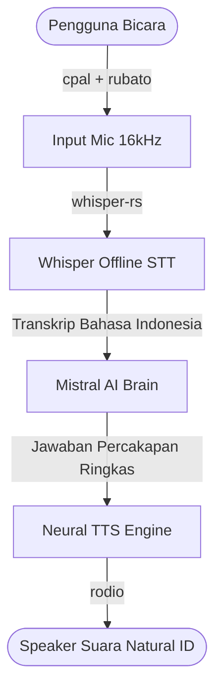

# AI-Voice (Rust) - Voice Assistant Bahasa Indonesia

## Status: Phase 1 & Phase 2 Selesai ✅

### Alur 2 Arah (Full Conversational Loop):


### Arsitektur Modul:
1. **Audio Input (`src/audio.rs`)**:
   - Perekaman suara microphone via `cpal`.
   - Konversi format dan resampling ke 16,000 Hz via `rubato`.
2. **Speech-to-Text (`src/stt.rs`)**:
   - Transkripsi offline menggunakan `whisper-rs` (model GGML `base` / `tiny`, bahasa `id`).
3. **Conversational AI Brain (`src/mistral.rs`)**:
   - Memproses pertanyaan & merawat konteks obrolan (*chat history*).
   - Menghasilkan respon natural dalam bahasa Indonesia lisan.
4. **Text-to-Speech Output (`src/tts.rs`)**:
   - Mengubah jawaban teks AI menjadi suara Bahasa Indonesia yang natural (`id-ID-GadisNeural` / `id-ID-ArdiNeural`).
   - Memutar audio langsung ke speaker via `rodio`.
5. **Main CLI App (`src/main.rs`)**:
   - Antarmuka interaktif Push-to-Talk via tombol `[SPASI]`.

---

### Konfigurasi `.env`:
```ini
# Model Whisper Offline
WHISPER_MODEL=base

# Mistral Configuration (Cloud API atau Local Ollama)
MISTRAL_BASE_URL=https://api.mistral.ai
MISTRAL_MODEL=mistral-small-latest
# MISTRAL_API_KEY=your_mistral_api_key_here

# Pilihan Suara Bahasa Indonesia:
# - id-ID-GadisNeural (Suara Wanita)
# - id-ID-ArdiNeural (Suara Pria)
TTS_VOICE=id-ID-GadisNeural
```
