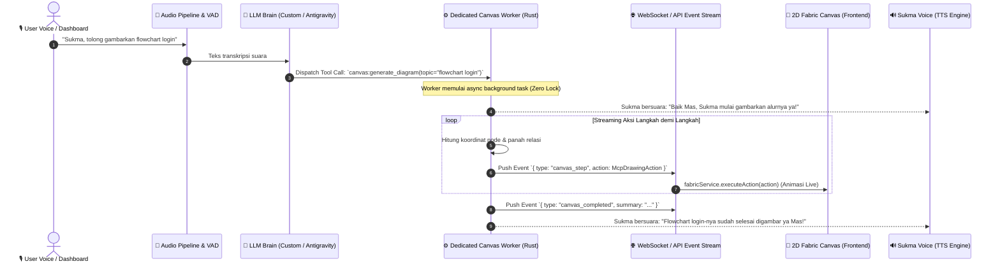

# 🎨 RAGASUKMA 2D CANVAS — MCP & BACKGROUND WORKER ARCHITECTURE PLAN

Dokumen ini merangkum status integrasi **2D Whiteboard MCP (Model Context Protocol)** saat ini, daftar aksi/tools yang **belum tersambung**, serta **rencana arsitektur Background Worker** (mengadopsi pola asinkron non-blocking seperti worker `yt-dlp` di Ragasukma).

---

## 📌 1. Status Saat Ini (Current State)

Frontend 2D Canvas dibangun menggunakan **Fabric.js v7** dan Solid.js dengan modularisasi mesin di `web/src/components/canvas/engine/`:
* **Core Engine**: Lifecycle, pan/zoom, snap-to-grid 24px, undo/redo history, dynamic stroke alignment (`center`, `inner`, `outer`).
* **Line & Arrow Engine**: Kontrol 2 endpoint handle profesional (`p1` & `p2`), rotasi bebas distorsi dengan 45° Shift-snapping, vector arrowhead dinamis (single `→`, double `↔`, none `—`), line style (`solid`, `dashed`, `dotted`), dan port magnetik.
* **Shape Builder Engine**: Pemecahan poligon bersinggungan (`splitIntoFragments`), union boolean geometry (`unionSelected`), dan preview arsiran (hatch) real-time.
* **Layers Engine**: Daftar objek real-time, drag & drop z-index reordering, lock, visibility, rename, delete.
* **Export & Import Engine**: Export PNG transparan, JPG, SVG vektor, crop seleksi objek, kunci rasio, scaling hingga 4K, serta import file gambar/clipboard/drop.
* **MCP Simulation Runner**: Mampu mengeksekusi rencana gambar langkah-demi-langkah beranimasi (`executePlanAnimated`) melalui `AiDrawingPanel.tsx`.

---

## 🛠️ 1.1 Evaluasi & Rencana Perampingan Toolbar (Ala Photoshop / Illustrator)

Agar tampilan kanvas tetap lega (*workspace-centric*) dan tidak penuh sesak seperti software profesional:

### Yang Perlu Ditingkatkan di Toolbar:
1. **Tool Grouping / Nested Flyout Menu (Dropdown Tool)**:
   - Mengelompokkan tool serupa di dalam 1 slot ikon dengan segitiga kecil di pojok (seperti *Flyout / Long-press* Photoshop/Illustrator):
     - Slot Bentuk: Kotak, Lingkaran, Diamond, Silinder.
     - Slot Garis: Garis Bebas, Panah 1 Ujung, Panah 2 Ujung, Konektor Relasi Siku.
     - Slot Seleksi: Direct Select (Pointer), Hand Tool (Pan).
2. **Quick Alignment & Distribution Bar**:
   - Belum ada tombol perataan instan untuk multi-seleksi (Rata Kiri, Rata Tengah Horisontal/Vertikal, Rata Kanan, dan Distribusi Jarak Merata). Ini sangat krusial saat merapikan bagan/flowchart.
3. **Pemisahan Toolbar Global vs Contextual Inspector**:
   - Toolbar Atas fokus murni pada *Tool Selection* & Operasi Kanvas Global (Export, Undo/Redo, Clear, Toggle AI MCP, Toggle Layers).
   - Seluruh properti objek (Color Picker, Stroke Width, Arrowheads, Opacity, Font Size, Group/Ungroup) dikunci tetap berada di Contextual Inspector/Floating Bar yang hanya muncul saat objek dipilih.

---

## 🎯 1.2 Solusi Agar AI Menggambar Tepat, Cepat, dan Presisi

Saat AI mengeksekusi perintah menggambar (diagram, flowchart, hingga bentuk bebas seperti roket atau logo), terdapat potensi ketidaktepatan geometri. Berikut solusi arsitektur yang direncanakan:

### 1. Normalisasi Origin Titik Koordinat (Top-Left vs Center)
* **Masalah**: Fabric.js secara internal menghitung posisi dari titik tengah (`originX/originY: 'center'`), sementara LLM hampir selalu berasumsi $(x, y)$ adalah sudut kiri atas (*top-left*). Ini menyebabkan bentuk bergeser sejauh $\text{width}/2$ dan $\text{height}/2$.
* **Solusi di MCP Engine**: Tambahkan fungsi sanitizer otomatis di `mcp.ts`:
  $$\text{realX} = \text{inputX} + \frac{\text{width}}{2}, \quad \text{realY} = \text{inputY} + \frac{\text{height}}{2}$$
  Jika LLM mengirim koordinat tanpa mendeklarasikan origin, engine otomatis mengonversi ke titik tengah yang presisi.

### 2. Auto-Fit Bounding Box terhadap Panjang Teks (No Overflow)
* **Masalah**: Ukuran kotak dari LLM bersifat statis. Jika label teks yang di-generate lebih panjang dari lebar kotak, teks akan keluar (*overflow*) dari batas kotak.
* **Solusi**: Ukur estimasi dimensi teks sebelum membuat objek:
  $$\text{minWidth} = (\text{charCount} \times \text{fontSize} \times 0.6) + \text{paddingHorisontal}$$
  Jika `width` dari AI lebih kecil dari `minWidth`, engine otomatis memperbesar kotak secara proporsional.

### 3. Grid-Snap Magnetik (Kelipatan 24px)
* **Masalah**: AI sering menghasilkan koordinat pecahan/desimal tidak bulat (misal $x = 103.4, y = 217.8$) sehingga garis penghubung terlihat miring 1-2 pixel.
* **Solusi**: Sebelum objek dimasukkan ke kanvas, lewati fungsi `snapToGrid(val, 24)` agar seluruh kotak, konektor, dan port snapping selalu sejajar sempurna di garis grid.

### 4. Menggambar Objek Kompleks (Roket, Logo, Maskot)
Untuk gambar yang bukan sekadar diagram flowchart (contoh: roket, logo, ikon custom):
* **Metode A - Komposisi Geometri (Preset)**: Menggabungkan beberapa primitif dasar terkoordinasi (lingkaran bodi roket + 2 segitiga poligon sayap + garis api bawah) yang dieksekusi berurutan secara live.
* **Metode B - SVG Path Data (`draw_path`)**: AI meng-output string path vektor SVG (misal `d="M 50,150 Q 50,50 100,20 Q 150,50 150,150 ... Z"`). Engine menggunakan `new Path(d)` Fabric.js untuk merender bentuk kurva bebas yang tajam dan akurat 100% tanpa distorsi.

---

## 🧩 2. Daftar Tools MCP yang Belum Tersambung & Status Implementasi

Berikut adalah inventaris lengkap status tool MCP antara **Frontend Engine (`types.ts` & `mcp.ts`)**, **Backend Worker**, dan **Voice Binding**:

| Kategori | Aksi MCP (`type`) | Frontend Engine | Backend Worker | Voice Binding | Deskripsi & Kegunaan |
| :--- | :--- | :---: | :---: | :---: | :--- |
| **Primitif Dasar** | `draw_rect` | ✅ Siap | ❌ Belum | ❌ Belum | Menggambar kotak / persegi panjang dengan opsi label dan rounded corner (`rx`, `ry`). |
| | `draw_circle` | ✅ Siap | ❌ Belum | ❌ Belum | Menggambar lingkaran dengan opsi radius, warna, dan label tengah. |
| | `draw_line` | ✅ Siap | ❌ Belum | ❌ Belum | Menggambar garis 2 titik (`x1, y1` ke `x2, y2`). |
| | `draw_arrow` | ✅ Siap | ❌ Belum | ❌ Belum | Menggambar panah vektor dinamis ber-endpoint kontrol dengan opsi label tengah. |
| | `draw_text` | ✅ Siap | ❌ Belum | ❌ Belum | Menambahkan teks bebas, judul, atau catatan dengan font & ukuran custom. |
| | `draw_path` | ✅ Siap | ❌ Belum | ❌ Belum | Menggambar path vektor custom SVG (misal ikon atau kurva bebas). |
| | `clear` | ✅ Siap | ❌ Belum | ❌ Belum | Mengosongkan kanvas gambar. |
| | `set_background` | ✅ Siap | ❌ Belum | ❌ Belum | Mengubah warna background kanvas. |
| **Bentuk Khusus Flowchart** | `draw_diamond` | ❌ Belum | ❌ Belum | ❌ Belum | Node belah ketupat untuk kondisi percabangan (*Decision Flowchart*). |
| | `draw_cylinder` | ❌ Belum | ❌ Belum | ❌ Belum | Bentuk silinder untuk komponen Database / Storage. |
| | `draw_card` | ❌ Belum | ❌ Belum | ❌ Belum | Wadah berheader + isi deskripsi (seperti card arsitektur cloud / entity). |
| **Manipulasi Objek** | `modify_object` | ❌ Belum | ❌ Belum | ❌ Belum | AI mengubah warna, teks label, ukuran, atau font objek yang sudah ada berdasarkan ID / nama layer. |
| | `move_object` | ❌ Belum | ❌ Belum | ❌ Belum | AI menggeser objek tertentu ke posisi koordinat baru (misal saat merapikan layout). |
| | `delete_object` | ❌ Belum | ❌ Belum | ❌ Belum | AI menghapus objek tertentu dari kanvas tanpa menghapus seluruh kanvas. |
| | `group_objects` | ❌ Belum | ❌ Belum | ❌ Belum | Mengelompokkan beberapa objek menjadi satu kesatuan layer. |
| **Media & Aset** | `add_image` | ❌ Belum | ❌ Belum | ❌ Belum | AI menempelkan logo/ikon/diagram eksternal dari URL atau base64 ke kanvas. |
| **Context Query** | `get_canvas_state` | ❌ Belum | ❌ Belum | ❌ Belum | AI membaca daftar objek yang sedang ada di layar sebelum memutuskan tindakan (read-before-write). |
| **Integrasi Sistem** | `canvas:draw_diagram` | ❌ Belum | ❌ Belum | ❌ Belum | Tool-call binding dari suara user (*"Sukma, gambarkan arsitektur microservices"*) langsung ke worker. |
| | `canvas:stream_step` | ❌ Belum | ❌ Belum | ❌ Belum | Event streaming WebSocket langkah-per-langkah dari backend ke frontend. |

---

## ⚙️ 3. Rencana Arsitektur Background Worker (Pola `yt-dlp`)

### Mengapa Memakai Background Worker Terdedikasi?
1. **Zero UI Lag / Non-Blocking**: Proses pembuatan rencana (*planning*), parsing token LLM, dan kalkulasi geometri berjalan di thread worker Rust terpisah tanpa mengganggu thread audio STT/TTS dan render 3D VRM.
2. **Step-by-Step Live Streaming**: Mengirim tiap langkah gambar secara langsung via WebSocket saat langkah itu selesai dihitung, menciptakan pengalaman visual langsung (*realtime typing & drawing*).
3. **Cancellable & Safe State**: Jika pengguna memotong pembicaraan (*voice interruption*) atau membatalkan perintah, worker langsung menghentikan eksekusi task (`AbortController` / `tokio::sync::broadcast`).

---

### 🌊 Alur Kerja Sistem (Sequence Flow)



---

## 📋 4. Rencana Skema JSON Tool-Calling Backend

Format standar yang akan didaftarkan ke LLM tool-calling backend:

```json
{
  "name": "canvas_draw_diagram",
  "description": "Menggambar diagram, arsitektur sistem, flowchart, atau relasi visual di papan gambar 2D",
  "parameters": {
    "type": "object",
    "properties": {
      "title": {
        "type": "string",
        "description": "Judul diagram yang digambar"
      },
      "clear_before": {
        "type": "boolean",
        "description": "Apakah kanvas perlu dibersihkan terlebih dahulu"
      },
      "steps": {
        "type": "array",
        "items": {
          "type": "object",
          "properties": {
            "action": {
              "type": "string",
              "enum": ["draw_rect", "draw_circle", "draw_diamond", "draw_cylinder", "draw_arrow", "draw_text", "draw_path", "add_image"]
            },
            "params": {
              "type": "object"
            },
            "description": {
              "type": "string"
            }
          },
          "required": ["action", "params"]
        }
      }
    },
    "required": ["title", "steps"]
  }
}
```

---

## 🚀 5. Checklist Tahapan Implementasi & Rincian Aksi

### Tahap 1: Ekstensi Frontend MCP Engine (`engine/mcp.ts` & `types.ts`)
- [ ] **Bentuk Khusus Flowchart**:
  - `draw_diamond`: Menghitung koordinat poligon 4 titik (`x, y - h/2`, `x + w/2, y`, `x, y + h/2`, `x - w/2, y`) + label di tengah.
  - `draw_cylinder`: Menggambar elips atas, kurva samping bawah, dan garis batas silinder + label.
  - `draw_card`: Rect wadah dengan pemisah header bar + judul teks + isi deskripsi.
- [ ] **Manipulasi Objek & Read Context**:
  - `modify_object`: Mencari objek via `obj.name` / `obj.id` lalu update `fill`, `stroke`, `strokeWidth`, `text`.
  - `move_object`: Animasi perpindahan objek ke `(newX, newY)` dengan tweening halus.
  - `delete_object`: Hapus objek spesifik tanpa membersihkan seluruh canvas.
  - `group_objects`: Menggabungkan beberapa objek menjadi `Group`.
  - `get_canvas_state`: Serialisasi ringkas objek-objek aktif (ID, label/teks, tipe, koordinat) untuk prompt LLM.
- [ ] **Media & Gambar**:
  - `add_image`: Load image dari URL atau base64 via `FabricImage.fromURL`.

### Tahap 2: Backend Dedicated Worker (Rust Tokio Task)
- [ ] Pembuatan modul `src/workers/canvas_worker.rs` (pola worker seperti `yt-dlp`).
- [ ] Parser prompt teks / perintah user menjadi layout nodes & panah otomatis (layout engine sederhana / grid-based dagre).
- [ ] Saluran broadcast WebSocket / SSE (`canvas:stream_step`, `canvas:completed`, `canvas:aborted`).
- [ ] Pengendali pembatalan task (`tokio_util::sync::CancellationToken`) saat ada user voice interruption.

### Tahap 3: LLM Tool Binding & Voice Integration
- [ ] Registrasi fungsi `canvas_draw_diagram` ke skema tool-calling LLM backend (Antigravity / Custom Provider).
- [ ] Menghubungkan trigger suara pipeline STT (*"Sukma gambarkan..."*) ke pemanggilan tool.
- [ ] Integrasi callback TTS Sukma saat penggambaran dimulai, saat menggambar, dan saat diagram selesai.

---
*Dokumen ini dibuat otomatis sebagai panduan arsitektur pengembangan fitur 2D Canvas & MCP di Ragasukma.*
