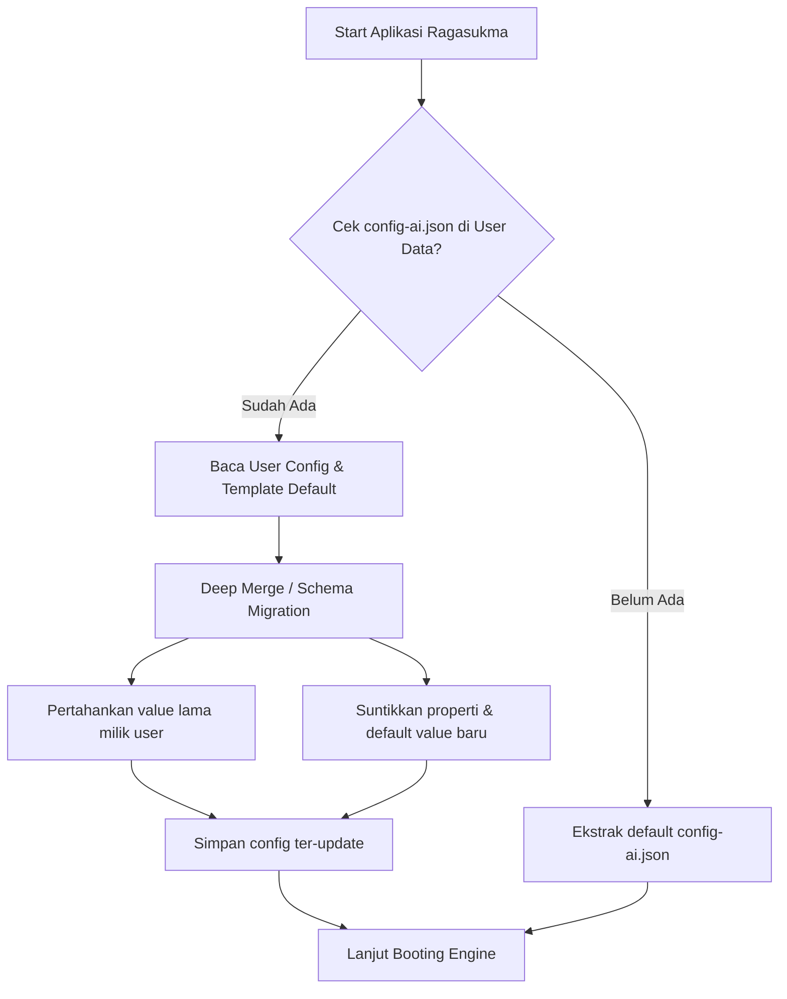

# Config Migration & Asset Persistence RFC

Dokumen ini mencatat rancangan penanganan aset pengguna dan pembaruan properti konfigurasi (`config-ai.json`) saat aplikasi Ragasukma AI mengalami pembaruan (app update).

---

## 1. Status Saat Ini (Current Behavior)

1. **Aset Pengguna (`char.vrm`, model suara, dsb.):**
   - Menggunakan mekanisme proteksi `if !target_path.exists()` pada fungsi inisialisasi aset (`src/assets.rs`).
   - File custom milik pengguna yang sudah ada di direktori data aplikasi (misal `~/.config/ragasukma/assets/char.vrm` di Linux atau `%APPDATA%\ragasukma\assets\char.vrm` di Windows) **tidak akan tertimpa** saat aplikasi diupdate.

2. **File Konfigurasi (`config-ai.json`):**
   - Saat ini menggunakan pendekatan yang sama: jika file `config-ai.json` sudah ada di folder config pengguna, aplikasi **melewatkannya** dan tidak melakukan rewrite.
   - **Masalah/Limitasi:** Jika terdapat penambahan atau perubahan properti baru di rilis Ragasukma versi mendatang, properti baru tersebut belum otomatis masuk ke file konfigurasi pengguna lama yang sudah ada.

---

## 2. Rencana Solusi: Auto-Merge / Migration System

Agar pembaruan konfigurasi berjalan mulus tanpa menghilangkan setelan kustom yang sudah diatur pengguna, sistem migrasi otomatis akan diterapkan:

### Mekanisme Implementasi:
1. **Schema / Version Check:**
   - Menyimpan field `version` atau membandingkan `serde_json::Value::Object` antara template default aplikasi dengan JSON user.
2. **Deep Merge Strategy:**
   - Kunci/properti yang sudah diatur pengguna tetap dipertahankan nilainya.
   - Kunci/fitur baru yang ada pada binary versi baru namun belum ada di config pengguna akan otomatis disuntikkan bersama nilai default-nya.
   - Kunci usang (*deprecated*) dapat dipertahankan atau dibersihkan secara aman tanpa merusak struktur utama.
3. **Backup Otomatis:**
   - Sebelum melakukan merge/penulisan ulang file konfigurasi, aplikasi dapat membuat salinan backup (misal `config-ai.json.bak`) untuk mencegah kerusakan data jika terjadi interupsi.
