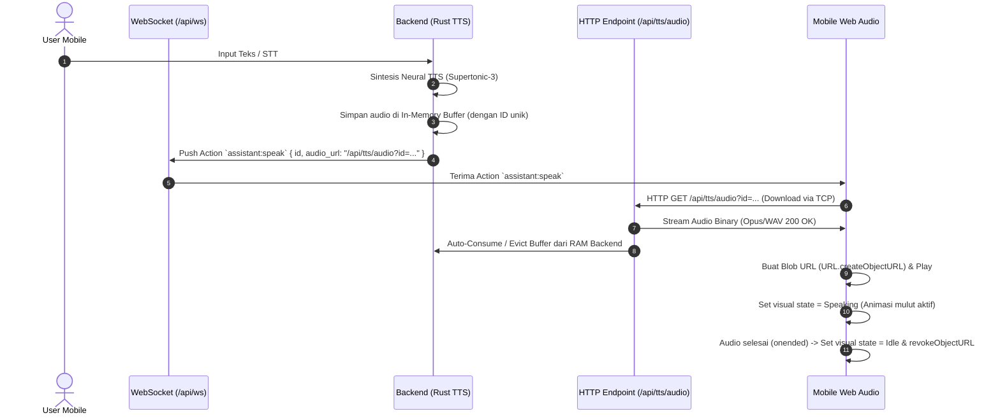

# Arsitektur Audio Streaming & Sinkronisasi State (Desktop & Mobile)

Dokumen ini menjelaskan arsitektur komunikasi data antara backend Ragasukma (Rust Axum/Tokio) dengan client Web Dashboard dan Mobile Companion.

---

## 1. Pemisahan Jalur Komunikasi (Clean Protocol Separation)

Untuk menjamin kestabilan koneksi (terutama saat diakses melalui Cloudflare Tunnel / jaringan seluler mobile):

| Jalur | Protokol | Endpoint | Fungsi |
| :--- | :---: | :--- | :--- |
| **Control Channel** | WebSocket | `GET /api/ws` | Event kontrol ringan (zero binary payload): `state`, `action`, `log`, `model_status`, dan heartbeat ping. |
| **Audio Binary (TTS)** | HTTP / TCP | `GET /api/tts/audio?id={id}` | Pengunduhan payload audio TTS mentah (Opus/WAV) menggunakan standard HTTP GET/TCP stream. |
| **Music Binary** | HTTP / TCP | `GET /api/music/stream` | Streaming file musik lokal via HTTP Range Request. |

---

## 2. Alur Eksekusi & Lifecycle TTS di Mode Mobile/Remote

---

## 3. Manajemen Memori & Auto-Eviction (Zero RAM Leak)

### Backend (Rust):
1. **Consume-on-Download**: Saat endpoint `GET /api/tts/audio?id={id}` berhasil diunduh oleh client, buffer audio dengan ID tersebut langsung di-drop dari memori.
2. **TTL Fallback Buffer**: Jika client mengalami kegagalan jaringan atau tidak pernah mengunduh audio, buffer otomatis dibersihkan dalam ring buffer (maks 3 item) atau expired setelah TTL 60 detik.
3. **Music Streaming**: Musik dibaca langsung dari storage disk per-range chunk (zero static RAM accumulation).

### Client / Mobile (TypeScript):
1. **Single Audio Instance**: Mobile hanya memutar 1 instance audio aktif secara sequential.
2. **Interruption / Barge-in**: Jika ada audio baru atau interupsi suara masuk, playback lama langsung dihentikan (`audio.pause()`) dan Blob URL lama di-revoke seketika (`URL.revokeObjectURL`).
3. **State Alignment**: State `speaking` di mobile hanya aktif saat audio hardware browser benar-benar memutar suara (`audio.onplay`), memastikan animasi 3D dan suara selaras 100%.
