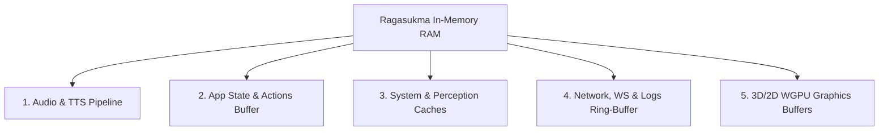

# Ragasukma In-Memory State & RAM Footprint Specification

Dokumen ini mendokumentasikan seluruh struktur data global, buffer, thread cache, dan state yang tersimpan di dalam RAM saat aplikasi Ragasukma berjalan.

---

## 1. Ringkasan Kategori RAM Storage

---

## 2. Rincian In-Memory Data per Modul

### 1. Audio, TTS & Player (`src/audio/`)
Menyimpan state pemutaran audio native, sink rodio, dan model TTS lokal.

| Variabel Global | Tipe / Guard | Estimasi Ukuran | Deskripsi & Lifecycle |
| :--- | :--- | :---: | :--- |
| `ENGINE` | `OnceLock<SupertonicEngine>` | ~50 – 120 MB | Model ONNX Supertonic-3 TTS (ONNX runtime weights & tokenizer) yang di-load sekali saat inisialisasi. |
| `LAST_AUDIO_WAV` | `Mutex<Option<(String, Vec<u8>)>>` | ~50 – 500 KB | Cache audio WAV sintesis terakhir untuk audio player lokal PC. |
| `LAST_AUDIO_OPUS` | `Mutex<Option<(String, Vec<u8>)>>` | ~10 – 60 KB | Cache audio chunk Opus yang di-encode untuk streaming instan ke client Mobile. |
| `NATIVE_VOICE_SINK` & `NATIVE_MUSIC_SINK` | `Mutex<Option<rodio::Sink>>` | ~1 – 2 MB | Audio output stream handle & decoding sink untuk speaker PC. |
| `ACTIVE_VOICE_SPEECH` | `Mutex<Option<ActiveVoiceSpeech>>` | ~100 KB | Status playback suara asisten saat ini (PCM sample tracking). |

---

### 2. App State & Action Dispatcher (`src/app_state.rs`)
Menyimpan koordinasi antar-thread (Renderer UI, LLM loop, Server, Companion).

| Variabel Global | Tipe / Guard | Estimasi Ukuran | Deskripsi & Lifecycle |
| :--- | :--- | :---: | :--- |
| `GLOBAL_SHARED_STATE` | `Mutex<Option<Arc<Mutex<ServerSharedState>>>>` | < 10 KB | State visual avatar (`Idle`, `Listening`, `Speaking`, `Thinking`), emotion, mute status, shutdown flag. |
| `CLIENT_ACTIONS_BUFFER` | `Mutex<VecDeque<ClientAction>>` | < 50 KB | Bounded FIFO queue (ring-buffer) untuk aksi AI yang akan dikirim ke client Web/Mobile. |
| `LAST_SPOKEN_TEXT` | `Mutex<Option<(String, Instant)>>` | < 2 KB | **Anti-Echolalia Buffer**: Mencegah mic merekam ulang suara asisten dari speaker PC. |
| `ACTIVE_WEB_SESSION` | `Mutex<Option<ActiveWebSession>>` | < 1 KB | Menyimpan Session ID tab browser yang sedang memegang kontrol. |
| `SPEAKING_EPOCH` / `INTERRUPT_FLAG` | `AtomicU64` / `AtomicBool` | 16 Bytes | Flag thread-safe ultra-cepat untuk voice interruption & cancellation. |

---

### 3. System Scanner & Vision Cache (`src/engine/`)
Cache hasil scanning sistem agar tidak membebani I/O & CPU secara berulang.

| Variabel Global | Tipe / Guard | Estimasi Ukuran | Deskripsi & Lifecycle |
| :--- | :--- | :---: | :--- |
| `APPS_CACHE` (`app_scanner.rs`) | `Mutex<Option<(Instant, Vec<InstalledApp>)>>` | ~20 – 100 KB | Cache daftar aplikasi desktop yang terinstall di OS (TTL/Refresh berkala). |
| `LAST_ACTIVE_SNAPSHOT` (`browser_session_service.rs`) | `Mutex<Option<BrowserDomSnapshot>>` | ~10 – 80 KB | DOM snapshot & tab list terakhir dari browser extension (Ground of Truth). |
| `TUNNEL_MANAGER` (`cloudflared.rs`) | `Mutex<Option<CloudflaredTunnelManager>>` | < 5 KB | Process handle, secret auth key, dan public URL Cloudflare Tunnel. |
| `VISION_SENDER` (`perception/mod.rs`) | `Mutex<Option<Sender<VisionRequest>>>` | < 1 KB | MPSC channel ke dedicated worker thread OCR/Vision. |

---

### 4. Logging & WebSocket Network Buffers (`src/config.rs`, `src/services/`)
Menyimpan histori log terminal dan channel broadcast WebSocket.

| Variabel Global | Tipe / Guard | Estimasi Ukuran | Deskripsi & Lifecycle |
| :--- | :--- | :---: | :--- |
| `LOG_BUFFER` (`config.rs`) | `Mutex<VecDeque<LogEntry>>` | ~100 – 300 KB | Bounded ring buffer log console (dibatasi maksimum 300 entri terakhir) untuk tab Logs UI. |
| Tokio WebSocket Channels | `tokio::sync::broadcast` | ~50 – 100 KB | Bounded channel buffer (kapasitas 128 pesan) untuk mendistribusikan event ke seluruh client aktif. |

---

### 5. Native 3D/2D WGPU Graphics Memory (`src/ui/`)
Alokasi memori VRAM / Host RAM untuk rendering overlay avatar.

| Resource | Lokasi | Estimasi Ukuran | Deskripsi |
| :--- | :--- | :---: | :--- |
| 3D VRM Mesh & Skeleton | VRAM / GPU RAM | ~15 – 40 MB | Node tulang GLTF/VRM, vertex buffers, blendshapes, dan shader pipelines. |
| 2D Avatar Textures | VRAM / Host RAM | ~5 – 15 MB | Texture sprite RGBA (Idle, Listening, Thinking, Speaking, Icon). |

---

## 3. Karakteristik Memori & Safety Summary

1. **Zero Unbounded Leaks**: Semua antrean (`LOG_BUFFER`, `CLIENT_ACTIONS_BUFFER`, WebSocket broadcast) berjenis **Bounded Buffer** dengan limitasi kapasitas tetap sehingga memori tidak akan membengkak seiring waktu.
2. **Deterministic Cleanup**: Audio buffer dibuang dan di-overwrite setelah pemutaran/pengiriman selesai.
3. **Total Idle Memory Footprint**: 
   - Mode 2D Avatar: **~70 – 110 MB RAM**
   - Mode 3D Avatar (dengan ONNX TTS & WGPU): **~160 – 240 MB RAM**
