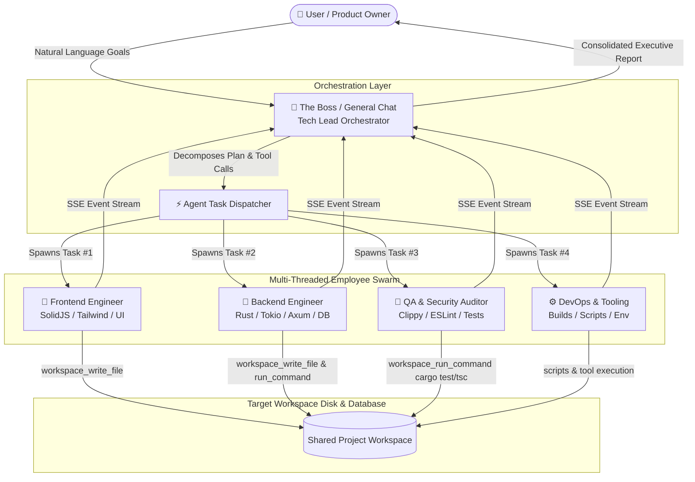

# 🏢 Plan: AI Orchestrator & Autonomous Employee Swarm

> **Concept**: Transform Ragasukma into a local autonomous "Virtual Software House", where the **General Chat acts as the Tech Lead / CEO ("The Boss")**, orchestrating and delegating tasks on-demand to specialized **AI Workers ("The Employees")** working in parallel.

---

## 1. High-Level Architecture



---

## 2. Core Entities & Roles

### 👑 The Boss (General Chat Orchestrator)
- **Role**: Technical Lead, Project Manager, and System Architect.
- **Model**: High-reasoning model (e.g. `gemini-3.8-flash`, Claude Sonnet, or GPT-4o).
- **Responsibilities**:
  - Understands broad, conversational, high-level requests from the user.
  - Explores the workspace or architectural landscape.
  - Breaks large objectives into independent, concrete, and parallelizable subtasks.
  - Assigns each subtask to the optimal employee persona and model.
  - Monitors execution status and synthesizes the final consolidated report.

### 👷 The Employees (Specialist Sub-Agents)
Each employee is defined by:
1. **Role / Title**: e.g., "Frontend Specialist", "Rust Core Engineer", "Security Reviewer".
2. **Prompt Skill Preset**: Specialized RFC-2119 operational guidelines and coding conventions.
3. **Dedicated Model**: Scaled to the task (e.g., cheaper/faster models for repetitive refactoring, reasoning models for algorithmic logic).
4. **Isolated Task Session**: Has its own session ID, message history, tool execution loop, and SSE streaming channel.

---

## 3. Orchestration Toolset (Boss Capabilities)

To empower the Boss to command employees autonomously, the Boss receives specialized agent tools:

### `swarm_spawn_task`
Creates and immediately launches an autonomous task session for a specific employee.
```json
{
  "project_id": "proj_123456",
  "employee_role": "frontend_specialist",
  "task_title": "Build Searchable Model Dropdown",
  "instructions": "Create SearchableSelect.tsx in web/src/components using SolidJS and Lucide icons.",
  "target_files": ["web/src/components/SearchableSelect.tsx"],
  "model_override": "ag/gemini-2.5-flash"
}
```

### `swarm_query_tasks`
Checks the live progress, running status, and tool output summary of all dispatched employee sessions.
```json
{
  "session_ids": ["sess_001", "sess_002"]
}
```

### `swarm_cancel_task`
Sends an immediate stop signal (`/api/agent/sessions/:id/stop`) to an employee session if requirements change.

---

## 4. Why This Architecture Wins

1. **True Parallel Concurrency**:
   - Rust's Tokio runtime already spawns detached threads (`tokio::spawn`) for each session.
   - Frontend and Backend can be written and verified at the exact same time without blocking each other.
2. **Context Window Protection (No Token Bloat)**:
   - The Boss does not inherit raw terminal logs or 1,000-line diffs generated by employees.
   - Employees work in clean, isolated context windows; only summarized results are reported back to the Boss.
3. **Cost & Speed Optimization**:
   - High-tier reasoning models are only used for the Boss (planning & architecture).
   - Fast, cost-effective models are dispatched for execution tasks (writing files, linting).
4. **Human-in-the-Loop Transparency**:
   - The user can view the Boss's high-level deliberations in General Chat, or switch to any Employee's sub-tab to inspect real-time tool execution, diffs, and terminal logs.

---

## 5. Implementation Roadmap

### Phase 1: Employee Personas & Database Schema
- [ ] Add `employee_presets` table in SQLite (`id`, `name`, `role`, `system_prompt`, `default_model`, `icon`).
- [ ] Pre-populate core software development roles (Frontend, Backend, QA, Fullstack).
- [ ] Associate task sessions with an optional `employee_id`.

### Phase 2: Boss Orchestrator Tools
- [ ] Implement `swarm_spawn_task` and `swarm_query_tasks` tools in `src/agent/tools.rs`.
- [ ] Enable the Boss prompt to recognize delegation intent from user queries.
- [ ] Implement result aggregation so the Boss waits for employee completion before reporting back.

### Phase 3: UI Swarm Dashboard
- [ ] **Org Chart / Swarm Monitor View** in the Dashboard:
  - Visual cards showing active tasks, employee avatars, assigned models, and real-time pulse indicators.
  - One-click navigation to inspect any employee's work in progress.
- [ ] Quick-assign employee selector when manually creating tasks.
