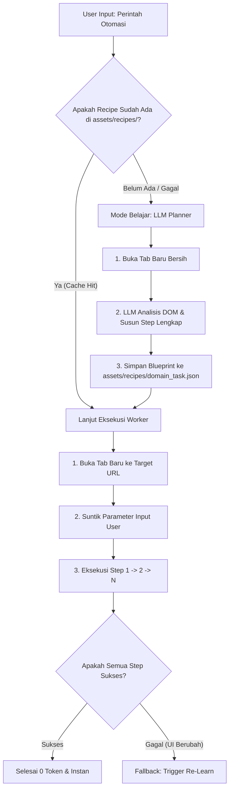

# Rencana Arsitektur: "Learn Once, Execute Locally" (Macro / Recipe System)

Dokumen ini menjelaskan arsitektur otomatisasi browser/desktop berbasis **Blueprint/Recipe**: LLM hanya berpikir sekali sampai tuntas untuk menyusun langkah (*recipe*), lalu disimpan lokal di `assets/recipes/` agar worker lokal bisa menjalankannya berulang kali dengan **0 token LLM** dan latensi instan.

---

## 1. Aturan Dasar: Buka Tab Baru (Isolated Clean State)

Setiap otomasi alur tugas web **wajib diawali dengan membuka Tab Baru** (atau navigasi bersih) ke URL target.

**Alasan krusial:**
1. **Mencegah Tab Pengguna Terganggu**: Tidak menimpa tab WhatsApp, YouTube, atau pekerjaan user yang sedang aktif.
2. **Kondisi Awal Bersih (Clean State)**: Memastikan elemen halaman mulai dari posisi awal yang deterministik (tidak terjebak di pop-up, modal, atau scroll tengah halaman sebelumnya).
3. **Tracking Terisolasi**: Worker lokal memegang `tab_id` baru tersebut secara eksklusif untuk mengeksekusi step sampai selesai.

---

## 2. Alur Dua Mode (Two-Phase Execution)



---

## 3. Struktur Penyimpanan: `assets/recipes/`

Folder: `assets/recipes/`
Contoh penamaan file:
- `assets/recipes/tokopedia_beli_pulsa.json`
- `assets/recipes/youtube_search_and_play.json`
- `assets/recipes/traveloka_cari_tiket.json`

### Contoh Skema JSON Recipe (`assets/recipes/tokopedia_beli_pulsa.json`):

```json
{
  "recipe_id": "tokopedia_beli_pulsa",
  "name": "Beli Pulsa di Tokopedia",
  "domain": "www.tokopedia.com",
  "version": 1,
  "created_at": 1790917200000,
  "required_params": ["phone_number"],
  "initial_action": {
    "action": "open_new_tab",
    "url": "https://www.tokopedia.com/"
  },
  "steps": [
    {
      "step": 1,
      "description": "Klik tombol menu Pulsa",
      "action": "click",
      "target_type": "button",
      "selector": "button.css-15yotyh",
      "fallback_candidates": ["pulsa", "top up pulsa"],
      "wait_after_ms": 600
    },
    {
      "step": 2,
      "description": "Ketik nomor telepon pengguna",
      "action": "type",
      "target_type": "input",
      "selector": "input[name='clientNumber']",
      "fallback_candidates": ["masukan nomor", "nomor telepon"],
      "value_template": "{{phone_number}}",
      "wait_after_ms": 500
    },
    {
      "step": 3,
      "description": "Klik tombol Beli / Lanjutkan",
      "action": "click",
      "target_type": "button",
      "selector": "button.css-1bbqckl-unf-btn",
      "fallback_candidates": ["beli", "checkout", "lanjutkan"],
      "wait_after_ms": 1000
    }
  ]
}
```

---

## 4. Keuntungan Konsep

1. **Hemat Token Nyaris 100%**: LLM hanya dipanggil 1 kali seumur hidup per tugas (atau saat website update UI besar-besaran).
2. **Kecepatan Eksekusi (Zero-Latency)**: Worker lokal Rust langsung menjalankan urutan step tanpa menunggu waktu respons API LLM.
3. **Resilien dengan Fallback**:
   - Selector utama (`selector`) dicoba pertama kali.
   - Jika gagal, gunakan `fallback_candidates` lokal.
   - Jika tetap gagal, barulah trigger LLM untuk memperbaiki (*re-learn*) resep tersebut (*self-healing*).
4. **Aman untuk Pengguna**: Buka di tab baru memastikan sesi kerja user yang lain tidak pernah tertutup atau terganggu.
