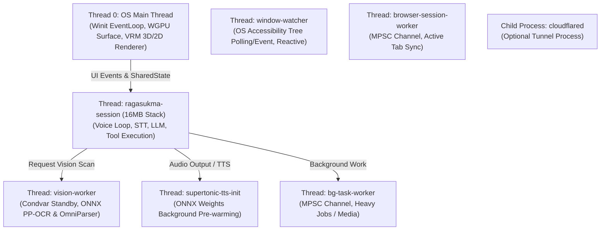

# Lifecycle & Resource Management Ragasukma

Dokumen ini mencatat seluruh daur hidup (lifecycle) resource, thread, proses latar belakang, dan alokasi memori/hardware di Ragasukma, mulai dari inisialisasi awal (Bootstrap), masa aktif (Runtime/Steady State), hingga penutupan aplikasi (Graceful Shutdown & Cleanup).

---

## 1. Arsitektur Threading & Alokasi Resource

Ragasukma dirancang dengan pembagian peran thread yang ketat untuk memastikan **0% CPU saat idle**, UI 3D/2D yang tetap mulus (60 FPS), dan I/O atau inference AI yang non-blocking:

---

## 2. Fase Lifecycle

### Fase 1: Bootstrap & Single-Instance Check (`main.rs`)

1. **DPI Awareness Setup (`init_dpi_awareness`)**
   - *Windows*: Menetapkan `SetProcessDpiAwarenessContext(DPI_AWARENESS_CONTEXT_PER_MONITOR_AWARE_V2)` agar koordinat cursor mouse, bounding box UI Automation, dan frame capture monitor sinkron 1:1 tanpa offset display scaling (125%, 150%, dst).

2. **Single-Instance Enforcement via Socket Pre-binding**
   - Mengikat port lokal `127.0.0.1:42128`.
   - Jika port sudah terikat:
     - Melakukan HTTP handshake ke `/api/ping`.
     - Jika instance Ragasukma sudah ada: membuka dashboard browser (`crate::assets::open_browser`) lalu proses keluar (`process::exit(0)`).
     - Jika dipakai aplikasi lain: menampilkan peringatan konflik port lalu keluar.
   - Socket listener yang berhasil dibind disimpan secara persisten (`register_prebound_listener`) tanpa di-drop untuk menghindari celah rasial TOCTOU (*Time-of-Check to Time-of-Use*).

3. **Asset & Local Workspace Preparation**
   - `ensure_default_user_assets()`: Menyalin konfigurasi default dan aset bawaan ke direktori pengguna (`~/.config/ragasukma/assets` atau `%APPDATA%`).
   - `cleanup_browser_sessions_on_startup()`: Membersihkan file cache dan snapshot browser sesi sebelumnya (`assets/active_tab_browser.json`, snapshot direktori).

---

### Fase 2: Spawn Worker Threads & Resource Allocation

Sebelum loop utama berjalan, thread-thread pekerja diinisialisasi dalam status hemat daya / standby:

| Worker Thread | Mekanisme Sinkronisasi | Resource / State yang Dikelola | Status Idle |
| :--- | :--- | :--- | :--- |
| **`vision-worker`** | `Mutex` + `Condvar` | Model ONNX (PP-OCRv4 + OmniParser Icon Detection), memory buffer visual | 0% CPU (Tidur menunggu request scan) |
| **`window-watcher`** | Event loop / polling interval | OS Accessibility Tree (Windows UI Automation / Linux ATSPI) | Memperbarui `assets/active_window_app.json` hanya saat ada pergantian jendela aktif |
| **`browser-session-worker`** | MPSC Channel | Browser session snapshot, tab metadata cache | Menunggu message update tab dari ekstensi browser |
| **`bg-task-worker`** | MPSC Channel (`crossbeam` / `std::sync::mpsc`) | Eksekusi tugas asinkronus (download video yt-dlp, konversi media) | Menunggu task baru |
| **`supertonic-tts`** | Background init thread | Runtime engine Supertonic-3, weights model neural TTS | Pre-load bobot ONNX ke RAM agar sintesis suara pertama tidak lag |

---

### Fase 3: Session & Graphics Runtime

1. **Session Thread (`ragasukma-session`)**
   - Dialokasikan dengan stack size besar (**16 MB**) untuk mencegah stack overflow saat deep recursion / audio processing di Linux AppImage & Windows.
   - Dibungkus dengan `std::panic::catch_unwind`: jika driver mikrofon/audio mengalami glitch, loop sesi otomatis memulihkan diri (*auto-recovery*) tanpa mematikan proses utama.
   - **Audio Input (STT)**: Stream CPAL menangkap audio input mikrofon secara streaming dengan sistem VAD (Voice Activity Detection).
   - **Audio Output (Rodio)**: Mengelola playback sink untuk audio respons TTS dan sound effects.

2. **OS Main Thread (Thread 0 - Native 3D VRM Overlay)**
   - Winit Event Loop dijalankan di Thread 0 (kewajiban platform Windows, Cocoa macOS, X11/Wayland).
   - **WGPU Pipeline**:
     - Device, Queue, dan Swapchain Surface terikat ke jendela transparan / click-through overlay.
     - Buffer Mesh VRM, Texture Sampler, dan Transform Bones dialokasikan di VRAM GPU.
     - Frame throttling otomatis saat mode idle / diminimalkan untuk menghemat daya GPU.

3. **External Child Process (`cloudflared`)**
   - Dikelola oleh `CloudflaredTunnelManager` via `std::sync::Mutex`.
   - Mengontrol child process executable `cloudflared` (status tunnel, public URL, ephemeral auth token).
   - Menangani auto-download binary mandiri ke `%LOCALAPPDATA%\ragasukma\bin\cloudflared.exe` di Windows tanpa dependensi pihak ketiga seperti WinGet.

---

### Fase 4: Graceful Shutdown & Cleanup

Shutdown dipicu baik dari penutupan jendela overlay, command `quit` dari Web Dashboard, maupun Tray Icon.

1. **Flag Propagasi (`GLOBAL_SHARED_STATE`)**
   - `trigger_app_shutdown()` menandai `is_shutdown = true` dan `is_running = false`.
   - Menghentikan loop pendengar VAD dan mikrofon.

2. **Terminasi Child Process**
   - `engine::cloudflared::stop_cloudflared_tunnel()` mengirim sinyal kill ke process child `cloudflared` dan menunggu wait status agar tidak meninggalkan proses zombie di OS.

3. **Tray & Worker Teardown**
   - `TrayState::push_command("quit")` membebaskan icon baki sistem (system tray).
   - `session_thread.join()` menunggu session thread menyelesaikan penulisan log / history percakapan ke disk.

4. **Resource Release**
   - Buffer WGPU dan Window handle dilepaskan saat event loop Winit menerima `Event::LoopExiting`.
   - `std::process::exit(0)` mengakhiri proses secara bersih.

---

## 3. Matriks Pencegahan Kebocoran Resource (Leak Prevention)

| Potensi Isu | Strategi Penanganan di Ragasukma |
| :--- | :--- |
| **Zombie Child Process (`cloudflared`)** | `CloudflaredTunnelManager::drop` & fungsi eksplisit `stop_cloudflared_tunnel` yang selalu dipanggil saat `main()` keluar dan saat `trigger_app_shutdown()`. |
| **TOCTOU Port Race Condition** | Listener TCP `42128` di-bind sekali pada bootstrap dan kepemilikannya dipertahankan (`register_prebound_listener`) hingga server aktif mengambil alih. |
| **Penyimpanan Cache Browser Membengkak** | `cleanup_browser_sessions_on_startup()` menghapus sisa file snapshot sementara setiap kali aplikasi dinyalakan ulang. |
| **High CPU pada Idle Worker** | `vision-worker` menggunakan `Condvar::wait`, tidak melakukan busy-loop polling saat tidak ada instruksi vision scan. |
| **Thread Panic mematikan App** | `ragasukma-session` thread dibungkus `catch_unwind` dengan auto-recovery delay (500ms). |
