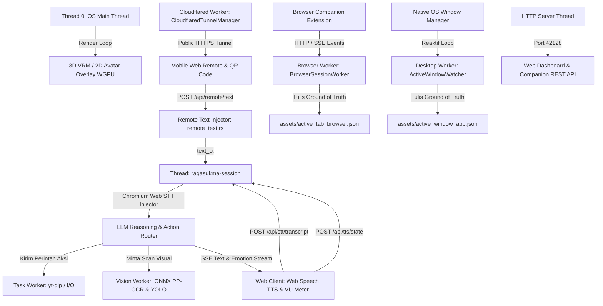

# ⚙️ Arsitektur Worker & Threading Ragasukma (`worker.md`)

Ragasukma dirancang menggunakan arsitektur **multi-threaded reaktif & non-blocking** di Rust native. Setiap tugas komputasi berat, I/O sistem operasi, persepsi visual, dan pemantauan lingkungan desktop diisolasi ke dalam *dedicated background worker thread* tersendiri agar sesi percakapan suara dan rendering avatar 3D tetap berjalan lancar dengan **0% CPU idle**.

---

## 🗺️ Peta Thread & Dedicated Workers

---

## 📋 Rincian Dedicated Workers di Ragasukma

### 1. 🌐 Browser Worker (`BrowserSessionWorker`)
* **File Sumber:** `src/services/browser_session_service.rs`
* **Lifecycle:** Selalu aktif di background thread sejak aplikasi dinyalakan.
* **Mekanisme Komunikasi:** `std::sync::mpsc::channel` (non-blocking event queue).
* **Tanggung Jawab:**
  * Menerima event DOM dan snapshot tab dari ekstensi browser *Ragasukma Companion* (Google Chrome, Brave, Edge, Chromium, Opera, Vivaldi via `.zip` extension).
  * Mengisolasi penulisan I/O file agar tidak memblokir thread HTTP server.
  * Menghasilkan file **`assets/active_tab_browser.json`** yang berisi daftar tab terbuka, elemen form input, tombol interaktif, dan teks snapshot DOM aktif sebagai *Ground of Truth* web.
  * Membersihkan session snapshot usang saat aplikasi pertama kali di-boot.

---

### 2. 🖥️ Desktop Worker (`ActiveWindowWatcher`)
* **File Sumber:** `src/engine/window_scanner.rs`
* **Lifecycle:** Selalu aktif di background thread secara reaktif.
* **Mekanisme:** Event polling adaptif (~200ms sleep) yang memantau perubahan handle jendela depan (`GetForegroundWindow`).
* **Tanggung Jawab:**
  * Mendeteksi pergantian jendela aplikasi aktif secara *real-time*.
  * Memindai elemen antarmuka jendela aktif via **Native OS Accessibility Tree**:
    * **Windows:** UI Automation (`IUIAutomation` + `TreeScope_Descendants`).
    * **Linux:** D-Bus AT-SPI (`atspi::zbus`).
    * **macOS:** Accessibility Framework (`AXUIElement`).
  * Mengekstrak seluruh daftar jendela yang terbuka di OS, kontrol tombol, kolom input, dan teks.
  * Menghitung titik tengah fisik elemen `center: [cx, cy]` dan menyimpannya ke **`assets/active_window_app.json`** sebagai *Ground of Truth* desktop.

---

### 3. 👁️ Vision Worker (`PerceptionEngine`)
* **File Sumber:** `src/engine/perception/`
* **Lifecycle:** Standby di thread terpisah (**0% CPU idle, 0 MB RAM idle**).
* **Mekanisme Komunikasi:** Request-response via `mpsc::channel`.
* **Engine Arsitektur:**
  * **Windows Native OCR (`Windows.Media.Ocr`)**: Menggunakan engine OCR bawaan sistem operasi Windows 10/11 langsung dari WinRT API tanpa perlu file model ONNX eksternal ataupun alokasi RAM persisten.
  * **Fallback Universal (`PaddleOCR`)**: Jika native OCR tidak tersedia atau pada Linux / macOS, memanggil fallback script Python `paddleocr` secara on-demand.
  * **OS Accessibility Tree**: Tombol, icon, input, dan menu native diekstrak langsung dari level OS (UI Automation di Windows, AT-SPI di Linux, Accessibility API di macOS).
* **Tanggung Jawab:**
  * Membaca layar secara visual murni ketika aplikasi tidak memiliki OS Accessibility Tree (misal game, canvas, custom UI, remote desktop).
  * Mengklasifikasikan angka kalkulator, tombol keypad, dan simbol operator (`+`, `-`, `*`, `/`, `=`, `%`) secara otomatis menjadi elemen interaktif yang bisa diklik.
  * Menghasilkan koordinat pixel fisik presisi tinggi yang sinkron dengan DPI sistem operasi.

---

### 4. 🚀 Background Task Worker (`BackgroundTaskWorker`)
* **File Sumber:** `src/engine/tasks.rs`
* **Lifecycle:** Aktif di background thread terpisah.
* **Mekanisme Komunikasi:** Antrean tugas `mpsc::channel` (`BackgroundTask`).
* **Tanggung Jawab:**
  * Mengeksekusi tugas-tugas sistem yang membutuhkan waktu lama (asinkron) agar suara asisten tidak terhenti / lag.
  * Mengunduh audio YouTube via `yt-dlp` di background saat pengguna meminta lagu baru yang belum ada di koleksi lokal.
  * Mengirim notifikasi status `is_busy`, persentase, dan status tugas (`task:started`, `task:completed`, `task:failed`) via SSE (Server-Sent Events) ke Web Dashboard dan System Tray.
  * Memutar otomatis lagu yang baru selesai diunduh ke audio speaker.

---

### 5. 🌐 Web Server & API Worker (`start_http_server`)
* **File Sumber:** `src/server.rs`
* **Lifecycle:** Berjalan di thread background terpisah pada port default `127.0.0.1:42128`.
* **Mekanisme:** Native multi-threaded TCP listener dengan auto-respawn per koneksi HTTP.
* **Tanggung Jawab:**
  * Menyajikan antarmuka Dashboard Web (SPA Vue / Tailwind yang di-bundle via `rust-embed`).
  * Menyediakan REST API dua arah untuk ekstensi browser *Ragasukma Companion*.
  * Mengalirkan audio file streaming dan status avatar.
  * Mencegah konflik single-instance melalui verifikasi port prebound listener.

---

### 6. 📱 Cloudflare Tunnel Worker (`CloudflaredTunnelManager`) & Remote Text Injector
* **File Sumber:** `src/engine/cloudflared.rs`, `src/engine/remote_text.rs`, & `src/services/remote_service.rs`
* **Lifecycle:** Dijalankan on-demand / otomatis dari Remote Tab desktop dan dipantau via background child process watchdog.
* **Mekanisme:**
  * Menjalankan binary `cloudflared` tanpa registrasi akun (`trycloudflare.com`) yang memetakan port internal `42128` ke HTTPS publik yang aman.
  * Memparsing URL publik secara asinkron dari output stream stdout/stderr process.
  * Menyediakan token autentikasi acak (`auth_key`) yang tersemat pada QR Code untuk otorisasi akses HP.
* **Tanggung Jawab:**
  * Memberikan akses kontrol jarak jauh untuk smartphone tanpa perlu port forwarding atau konfigurasi router.
  * Menerima payload teks perintah dari antarmuka Web HP (`POST /api/remote/text?key=...`).
  * Menyuntikkan teks langsung ke antrean `text_rx` pada percakapan aktif (`REMOTE_TEXT_INJECTOR`), mengosongkan buffer mic PC agar tidak feedback, atau otomatis memicu `start_chat` jika sesi asisten sedang standby.
  * Mengisolasi kill tree proses subprocess (`taskkill /F /T` di Windows) saat aplikasi ditutup agar tidak meninggalkan proses zombie di background.

---

### 7. 🎙️ Voice Session Worker (`ragasukma-session`) & Pure Web Speech Architecture
* **File Sumber:** `src/main.rs`, `src/engine/session.rs`, `src/engine/chat_loop/`, & `src/audio/tts.rs`
* **Lifecycle:** Berjalan di thread terpisah dengan kapasitas stack besar (**16 MB stack size**) untuk kestabilan inferensi lintas platform.
* **Tanggung Jawab:**
  * Mengelola state percakapan interaktif melalui pipeline **Chromium Web Speech API**.
  * Menerima transkrip suara pengguna dari web frontend (`POST /api/stt/transcript`) secara instan dan menyuntikkannya ke prompt loop.
  * Menggabungkan konteks *Ground of Truth* dari Browser Worker (`active_tab_browser.json`) dan Desktop Worker (`active_window_app.json`) ke dalam prompt LLM.
  * Menjalankan **Action Router Orchestrator** untuk mengeksekusi tag aksi `[CMD:...]` secara instan di background tanpa memblokir percakapan.
  * **Zero Backend Audio Overhead**:
    * **Pure Web Speech & Zero Audio Device Lock**: Tidak ada thread recorder atau VAD backend yang mengunci hardware mikrofon. Mikrofon ditangkap langsung oleh browser (`webkitSpeechRecognition`), transkrip dikirim via `POST /api/stt/transcript`, dan output suara disintesis via `window.speechSynthesis`.
    * **Sinkronisasi Reaktif Satu Pintu**: Status suara (`speaking: true/false`, `emotion`) disinkronkan secara instan via `POST /api/tts/state` untuk menjaga konsistensi state avatar WGPU dan system tray.
    * Visualizer Spectrum & VU Meter menggunakan **Web Audio API native browser** (`AudioContext` + `AnalyserNode`) pada 60 FPS dengan 0ms latency dan 0% beban CPU backend.
    * Voice interruption (*barge-in*), mic mute (`recognition.abort()`), dan TTS mute (`speechSynthesis.cancel()`) diputus langsung di sisi web.
    * Backend hanya mempertahankan modul `rodio` murni untuk pemutaran musik MP3 lokal (`media:play`).

---

### 8. 🖥️ OS Main Render Thread (Thread 0)
* **File Sumber:** `src/ui/mod.rs` & `src/main.rs`
* **Lifecycle:** Berjalan di Thread 0 sistem operasi (kebutuhan wajib driver grafis Windows / macOS Cocoa / Linux X11/Wayland).
* **Tanggung Jawab:**
  * Mengontrol event loop windowing `winit`.
  * Merender 3D VRM Model / 2D Avatar Overlay menggunakan backend grafis native **WGPU** (DirectX 12, Vulkan, atau Metal).
  * Menggerakkan animasi ekspresi emosi (*senang, malu, semangat, kaget, mikir, sedih, marah*) serta kalkulasi lip-sync bibir secara real-time.
