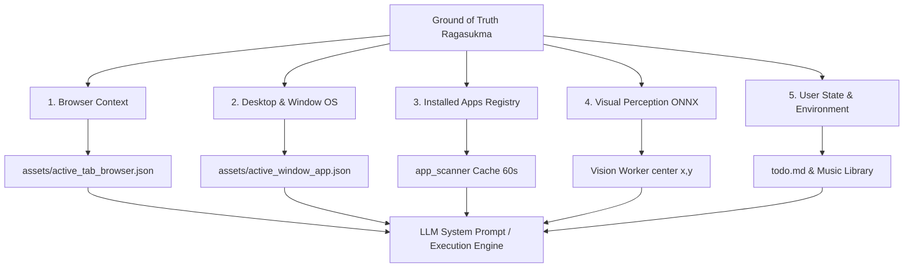

# 🌐 Ground of Truth Architecture (`groundoftruth.md`)

Dokumentasi resmi seluruh pilar dan sumber kebenaran data faktual (*Ground of Truth*) yang disuntikkan secara dinamis ke dalam memori LLM Ragasukma.

---

## 🎯 Filosofi & Prinsip Utama
LLM (Large Language Model) secara alami memiliki tendensi berhalusinasi (*hallucination*), menebak nama aplikasi, menebak simbol tombol, atau mengarang elemen interaktif yang tidak ada di layar.

Untuk mengatasi ini, **Ragasukma menerapkan prinsip "Zero Guessing / Strict Ground of Truth"**:
1. AI dilarang menebak elemen layar atau koordinat secara bebas.
2. Semua aksi interaktif (`desktop:*`, `browser:*`, `app:*`) **WAJIB** merujuk pada salah satu berkas atau snapshot state faktual yang disediakan oleh sistem secara *real-time*.
3. Setiap pilar Ground of Truth memiliki *update mechanism* dan *caching strategy* agar 0% CPU idle saat tidak dibutuhkan.
4. **Dynamic Prompt Indexing**: Data Ground of Truth disuntikkan secara dinamis (*on-demand*) berbasis intent ucapan pengguna (`route_prompt_indexes`) sehingga tidak pernah mendump seluruh data secara membabi buta. Jika obrolan biasa, prompt bebas beban (hemat 80-90% token).
5. **Two-Step Agentic Loop (Index $\rightarrow$ Focus $\rightarrow$ Content Read)**:
   * **Tahap 1 (Index Level)**: LLM membaca index ringan (misal: daftar nama jendela terbuka di OS). LLM memanggil `[CMD:desktop:focus|App]` atau `[CMD:app:open|App]`.
   * **Eksekusi & Auto-Scan**: Engine memfokuskan jendela dan secara otomatis memindai seluruh tombol/elemen dari jendela yang baru aktif di depan.
   * **Tahap 2 (Content Level)**: Engine mengirimkan observasi tombol jendela aktif ke LLM, lalu LLM mengeksekusi aksi lanjutan (`[CMD:desktop:click_button|ID]`) dengan akurasi 100% tanpa perlu menunggu pengguna bicara lagi!

---

## 🏛️ 5 Pilar Ground of Truth Ragasukma

---

### 1. 🌐 Browser Context Ground of Truth
* **Berkas Penyimpan:** `assets/active_tab_browser.json`
* **Penyedia Data (*Worker*):** `BrowserSessionWorker` via ekstensi browser resmi *Ragasukma Companion* (Chrome / Brave / Edge).
* **Frekuensi Pembaruan:** Event-driven (saat tab berganti, URL berubah, atau DOM selesai dimuat).
* **Data yang Disuntikkan:**
  * **Tab Terbuka:** ID tab, URL, judul halaman web, dan status aktif.
  * **Halaman Web Aktif:** Title, URL, Domain, serta daftar elemen interaktif (Input Form, Button, Text Links, Selector CSS/ID).
* **Aksi Terkait:**
  * `[CMD:browser:switch|judul_atau_url]`
  * `[CMD:browser:click_text|teks_link]` (Pencocokan teks exact/starts-with, pelindung karakter tunggal)
  * `[CMD:browser:click_button|selector_atau_label]`
  * `[CMD:browser:type|teks]` & `[CMD:browser:enter]`

---

### 2. 🖥️ Desktop & Window Management Ground of Truth
* **Berkas Penyimpan:** `assets/active_window_app.json`
* **Penyedia Data (*Worker*):** `ActiveWindowWatcher` (Native OS thread, 1.5 detik interval / event-driven).
* **Mekanisme OS Native (Cross-Platform):**
  * **Windows:** Windows UI Automation (UIA) & Win32 API (`GetForegroundWindow`, `EnumWindows`).
  * **macOS:** AppleScript `System Events` (mengambil jendela aktif, daftar jendela terbuka, serta elemen tombol/UI).
  * **Linux:** X11 (`_NET_ACTIVE_WINDOW`, `_NET_CLIENT_LIST`) & Wayland compositor API.
* **Data yang Disuntikkan:**
  * **Jendela Aktif Saat Ini:** Nama proses aplikasi (`app_name`) dan judul jendela (`window_title`).
  * **Daftar Jendela Terbuka di Seluruh OS:** Jendela-jendela yang sedang berjalan di taskbar/dock beserta status aktif/latar belakang.
  * **Tombol / Kontrol Desktop:** ID dan label resmi tombol (misal: `#15: "Seven"` atau `#23: "Plus"` pada Windows Calculator).
  * **Kolom Input & Teks Aksesibilitas.**
* **Aksi Terkait:**
  * `[CMD:desktop:focus|nama_jendela_atau_app]` (Membawa jendela latar belakang ke depan).
  * `[CMD:desktop:click_button|nama_atau_id_tombol]` (Didukung auto-focus target window & pelindung pencocokan substring karakter tunggal).
  * `[CMD:desktop:minimize]`, `[CMD:desktop:maximize]`, `[CMD:desktop:close]`.

---

### 3. 🚀 Installed Applications Ground of Truth
* **Modul Penyedia:** `crate::engine::app_scanner`
* **Format Prompt:** `load_installed_apps_summary()`
* **Frekuensi Pembaruan:** In-memory caching dengan TTL 60 detik (sangat ringan, < 1ms untuk pembacaan LLM berikutnya).
* **Mekanisme OS Native (Cross-Platform):**
  * **Windows:**
    * Start Menu Programs (`%APPDATA%\Microsoft\Windows\Start Menu\Programs` & `%ProgramData%`).
    * Windows Registry App Paths (`HKLM` & `HKCU\Software\Microsoft\Windows\CurrentVersion\App Paths`).
  * **Linux:** Direktori Desktop Entry (`/usr/share/applications/*.desktop` & `~/.local/share/applications/*.desktop`).
  * **macOS:** Direktori aplikasi bawaan (`/Applications/*.app` & `~/Applications/*.app`).
* **Data yang Disuntikkan:**
  * Daftar nama aplikasi yang benar-benar terpasang di sistem operasi pengguna (misal: `Calculator`, `Google Chrome`, `Visual Studio Code`, `Spotify`, `Steam`, `Zed`).
* **Aksi Terkait:**
  * `[CMD:app:open|NamaAplikasi]` (Hanya membuka aplikasi yang benar-benar terdaftar di sistem).

---

### 4. 👁️ Visual Perception Ground of Truth (Fallback & Custom GUI)
* **Modul Penyedia:** `crate::engine::perception` (`Vision Worker`)
* **Trigger:** Perintah eksplisit `[CMD:desktop:scan_visual]` (atau user minta baca layar).
* **Mekanisme & AI Model:**
  * Tangkapan layar resolusi penuh via `xcap`.
  * **DPI / Retina Awareness:**
    * Windows: Per-Monitor Aware V2 (1:1 koordinat fisik ke `SetCursorPos`).
    * macOS: Skala divisor Retina (~2.0) dari `scale_factor()` untuk translasi ke titik Cocoa/AppleScript.
    * Linux: 1:1 physical pointer coordinates.
  * Model ONNX lokal ultra-ringan:
    * **PP-OCRv4:** Deteksi teks dan karakter (angka kalkulator, label custom, teks menu).
    * **OmniParser / Icon Detector:** Deteksi tombol visual dan ikon tanpa label teks.
  * **Klasifikasi Tombol Pintar (`is_button_like_text`):** Angka tunggal (`0`-`9`), simbol matematika (`+`, `-`, `×`, `÷`, `=`, `%`), dan singkatan kalkulator (`CE`, `C`, `DEL`, `MC`, `MR`) otomatis diberi `role: "button"`.
* **Siklus Memori:**
  * Gambar screenshot buffer (`DynamicImage`) **langsung di-drop / dibuang dari memori RAM** seketika setelah deteksi selesai.
* **Data yang Disuntikkan:**
  * Posisi titik tengah persis: `"center": [x, y]` dan batas kotak `"bbox": [x1, y1, x2, y2]`.
* **Aksi Terkait:**
  * `[CMD:desktop:click_at|x|y]` (Mengklik koordinat nyata hasil deteksi visual).
  * `[CMD:desktop:click_button|nama_tombol]` (Bisa menggunakan label visual hasil OCR).

---

### 5. 📝 User State & Local Environment Ground of Truth
* **Sumber Data:**
  * **Agenda / Catatan Tugas:** `assets/todo.md` (`load_todo_summary()`).
  * **Koleksi Musik Lokal:** Folder musik pengguna yang dipindai langsung dari penyimpanan disk oleh `ytdlp::list_downloaded` (`load_local_music_summary()`).
* **Data yang Disuntikkan:**
  * Daftar to-do harian yang masih aktif atau sudah selesai.
  * Daftar judul lagu yang benar-benar tersimpan di folder musik lokal komputer pengguna.
* **Aksi Terkait:**
  * `[CMD:todo:add|tugas]` & `[CMD:todo:done|tugas]`
  * `[CMD:media:play|judul]` (Memutar file lokal jika sudah ada, atau otomatis mengunduh jika belum).

---

## 🛡️ Guardrails & Pencegahan Mismatch

| Masalah Klasik AI | Solusi Ground of Truth Ragasukma |
| :--- | :--- |
| **Salah Klik Karakter Tunggal** (misal: cari tombol `C` malah klik `CE`, atau cari `+` malah klik `M+`) | **Single-character guard:** Larang greedy `.contains()`. Karakter tunggal (`len() == 1`) wajib pencocokan exact match. |
| **Klik Jendela Latar Belakang** (misal: pengguna sedang di IDE Zed, menyuruh klik angka di kalkulator) | **Auto-Focus Guard:** Engine otomatis memanggil `focus_window` ke jendela target sebelum mengeksekusi klik. |
| **Menebak Nama File Executable** (misal: memanggil `calc.exe` atau `c:\\path\\...`) | **App Registry Scanner:** LLM hanya memilih dari nama aplikasi yang tercantum di daftar Ground of Truth `app_scanner`. |
| **Halusinasi Koordinat Layar** (misal: mengarang angka koordinat sembarangan `click_at\|500\|300`) | **Vision Center Verification:** Aksi `click_at` hanya valid jika koordinatnya cocok dengan hasil output `desktop:scan_visual`. |
| **Perbedaan Resolusi HiDPI / Retina** (mouse meleset karena scale 125%, 150%, atau Retina 200%) | **DPI Virtualization Lock:** Windows menggunakan *PerMonitorAwareV2*, macOS menggunakan *Divisor Scale Factor*. |
