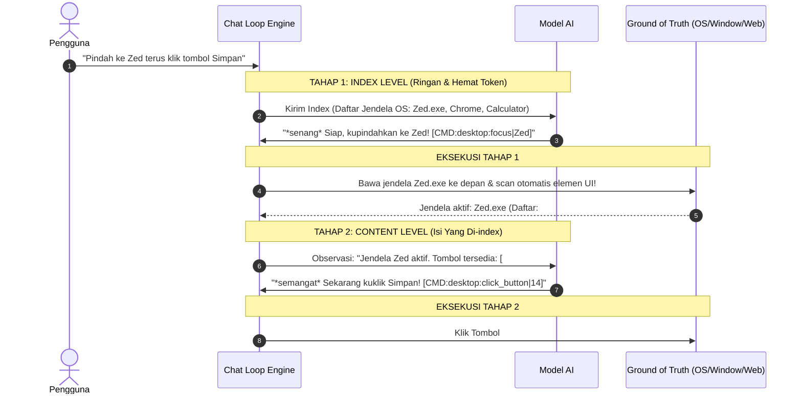

# 🛠️ Ragasukma Skill & Action Registry (`skillcode.md`)

Dokumentasi format canonical action `namespace:action|payload` yang dapat dieksekusi oleh AI Agent, Voice Command, UI Shortcut, atau HTTP API Ragasukma, lengkap dengan contoh kalimat instruksi pengguna (*voice prompt*).

---

## 📑 Daftar Namespace, Skill & Kemungkinan Perintah

### 1. 🖥️ Desktop & Window Management (`desktop:*`, `vision:*`)
Digunakan untuk navigasi antar-jendela aplikasi, membaca UI (Accessibility Tree & Visual ONNX OCR), serta kontrol jendela desktop.

| Action Identifier | Deskripsi | Parameter | Kemungkinan Perintah Pengguna (Voice / Chat) | Tag Command AI |
| :--- | :--- | :--- | :--- | :--- |
| `desktop:scan` | Memindai elemen jendela aktif via Native OS Accessibility Tree (0% CPU, respon < 1ms). | - | *"Cek aplikasi apa yang lagi kebuka", "Lihat tombol apa saja di aplikasi ini", "Baca elemen jendela aktif"* | `[CMD:desktop:scan]` |
| `desktop:scan_visual` (alias: `vision:scan`, `desktop:ocr`) | Memindai layar secara visual dengan PP-OCR dan OmniParser Icon Detection, menghasilkan koordinat pixel `center: [x, y]`. | - | *"Lihat layarku sekarang", "Baca tulisan di layar", "Pindai layar secara visual", "Cek ada apa di layar ini"* | `[CMD:desktop:scan_visual]` |
| `desktop:focus` | Mengaktifkan dan memfokuskan jendela tertentu ke depan. | `<title / app>` | *"Pindah ke Chrome", "Buka jendela Spotify", "Fokus ke VS Code", "Tampilkan Notepad"* | `[CMD:desktop:focus\|chrome.exe]` |
| `desktop:minimize` | Me-minimize jendela tertentu atau jendela aktif. | Opsional: `<title>` | *"Minimize jendela ini", "Kecilkan layar Notepad", "Turunkan jendela sekarang"* | `[CMD:desktop:minimize]` |
| `desktop:maximize` | Me-maximize atau restore jendela. | Opsional: `<title>` | *"Perbesar jendela ini", "Maksimalkan layar", "Restore window"* | `[CMD:desktop:maximize]` |
| `desktop:close` | Menutup jendela aplikasi tertentu atau jendela aktif. | Opsional: `<title>` | *"Tutup jendela ini", "Close Notepad", "Tutup aplikasi kalkulator"* | `[CMD:desktop:close\|Notepad]` |
| `desktop:click_button` | Mengklik tombol atau ikon pada jendela aktif. | `<label / id>` | *"Klik tombol Simpan", "Pencet tombol Next", "Klik Cancel", "Pilih tombol Kirim"* | `[CMD:desktop:click_button\|Simpan]` |
| `desktop:click_at` | Mengklik mouse tepat pada koordinat pixel layar `[x, y]`. | `<x>\|<y>` | *"Klik ikon di kanan atas", "Pencet tombol di koordinat itu", "Klik di titik 1829 15"* | `[CMD:desktop:click_at\|1829\|15]` |
| `desktop:type` | Mengirim input ketikan keyboard ke elemen yang sedang fokus. | `<text>` | *"Ketik halo semuanya", "Tuliskan catatan ini", "Input nama saya"* | `[CMD:desktop:type\|Halo Ragasukma]` |
| `desktop:key` | Menekan tombol khusus pada keyboard (Enter, Esc, Tab, dll). | `<key_name>` | *"Tekan enter", "Pencet tombol escape", "Tekan tab", "Kirim enter"* | `[CMD:desktop:key\|enter]` |

---

### 2. 🌐 Browser Automation (`browser:*`)
Berkomunikasi langsung dua arah dengan browser (Google Chrome, Brave, Edge, Chromium) melalui ekstensi bawaan *Ragasukma Companion*.

| Action Identifier | Deskripsi | Parameter | Kemungkinan Perintah Pengguna (Voice / Chat) | Tag Command AI |
| :--- | :--- | :--- | :--- | :--- |
| `browser:open` | Membuka URL atau domain baru di browser (otomatis switch jika tab sudah ada). | `<url / domain>` | *"Buka youtube", "Buka situs github.com", "Tolong buka chatgpt", "Buka tab google"* | `[CMD:browser:open\|youtube.com]` |
| `browser:search` | Mencari di dalam tab web aktif atau mencari ke situs spesifik. | `<query>` atau `<domain>\|<query>` | *"Cari di youtube denny caknan", "Search lagu lofi di youtube", "Cari tulisan kontak di halaman ini"* | `[CMD:browser:search\|youtube.com\|denny caknan]` |
| `browser:click_button` | Mengeklik tombol interaktif di dalam halaman web. | `<selector / label>` | *"Klik tombol Subscribe", "Pencet tombol Kirim", "Klik login di web", "Klik submit"* | `[CMD:browser:click_button\|Subscribe]` |
| `browser:click_text` | Mengeklik teks atau link yang ada di halaman web. | `<label teks>` | *"Klik tulisan Masuk", "Klik video pertama", "Pencet link Dokumentasi"* | `[CMD:browser:click_text\|Login]` |
| `browser:type` | Mengetikkan teks ke input formulir web yang sedang aktif. | `<teks>` | *"Ketik tutorial rust di kolom pencarian", "Tuliskan email saya", "Input username admin"* | `[CMD:browser:type\|tutorial rust]` |
| `browser:enter` | Mengirim penekanan tombol Enter pada web. | - | *"Tekan enter di web", "Enter pencariannya", "Kirimkan inputnya"* | `[CMD:browser:enter]` |
| `browser:scroll` | Menggeser halaman web ke atas atau ke bawah. | `<jarak_pixel>` | *"Scroll ke bawah", "Geser ke atas sedikit", "Scroll ke paling bawah"* | `[CMD:browser:scroll\|400]` |
| `browser:switch` | Berpindah ke tab browser tertentu berdasarkan judul atau URL. | `<judul tab / URL>` | *"Pindah ke tab WhatsApp", "Buka tab YouTube tadi", "Beralih ke tab GitHub"* | `[CMD:browser:switch\|WhatsApp]` |
| `browser:close` | Menutup tab browser tertentu atau tab aktif. | `<judul tab / URL>` | *"Tutup tab ini", "Close tab YouTube", "Tutup tab Google"* | `[CMD:browser:close\|YouTube]` |

---

### 3. 🚀 Application Launcher (`app:*`)
Membuka dan meluncurkan aplikasi yang terpasang di sistem operasi (Windows, Linux, macOS).

| Action Identifier | Deskripsi | Parameter | Kemungkinan Perintah Pengguna (Voice / Chat) | Tag Command AI |
| :--- | :--- | :--- | :--- | :--- |
| `app:open` | Membuka aplikasi sistem / utilitas (Kalkulator, Notepad, Spotify, dll). | `<nama aplikasi>` | *"Buka kalkulator", "Jalankan calc", "Buka notepad", "Buka terminal", "Buka file explorer"* | `[CMD:app:open\|Calculator]` |
| `app:open` | Membuka pemutar musik / streaming. | `<nama aplikasi>` | *"Buka Spotify", "Jalankan Spotify", "Nyalakan Spotify"* | `[CMD:app:open\|Spotify]` |
| `app:open` | Membuka text editor atau IDE koding. | `<nama aplikasi>` | *"Buka VS Code", "Jalankan Visual Studio Code", "Buka Zed editor"* | `[CMD:app:open\|Visual Studio Code]` |
| `app:open` | Membuka browser web utama. | `<nama aplikasi>` | *"Buka Google Chrome", "Nyalakan Chrome", "Jalankan browser Brave"* | `[CMD:app:open\|Google Chrome]` |
| `app:open` | Membuka aplikasi chat atau produktivitas. | `<nama aplikasi>` | *"Buka Discord", "Jalankan Telegram", "Buka Notion", "Buka Obsidian"* | `[CMD:app:open\|Discord]` |

---

### 4. ⚙️ System & OS Controls (`os:*`)
Aksi utilitas sistem bawaan lintas OS (Windows, Linux, macOS).

| Action Identifier | Deskripsi | Parameter | Kemungkinan Perintah Pengguna (Voice / Chat) | Tag Command AI |
| :--- | :--- | :--- | :--- | :--- |
| `os:volume_up` | Menaikkan volume suara komputer (+10%). | - | *"Besarkan volume", "Naikkan suara", "Kurang keras suaranya", "Volume up"* | `[CMD:os:volume_up]` |
| `os:volume_down` | Menurunkan volume suara komputer (-10%). | - | *"Kecilkan volume", "Turunkan suara", "Terlalu keras suaranya", "Volume down"* | `[CMD:os:volume_down]` |
| `os:mute` | Mematikan atau menyalakan suara (mute/unmute toggle). | - | *"Mute suara", "Matikan suara laptop", "Unmute audio", "Senyapkan komputer"* | `[CMD:os:mute]` |
| `os:screenshot` | Mengambil tangkapan layar monitor komputer. | - | *"Ambil screenshot", "Tolong screenshot layar", "Tangkap gambar layar ini"* | `[CMD:os:screenshot]` |
| `os:lock` | Mengunci workstation / sesi layar komputer. | - | *"Kunci layar", "Lock workstation", "Kunci komputer sekarang"* | `[CMD:os:lock]` |

---

### 5. 🎵 Music & Media Player (`media:*`)
Pengontrol musik latar belakang internal dengan dukungan pemutar lokal dan downloader audio YouTube (yt-dlp).

| Action Identifier | Deskripsi | Parameter | Kemungkinan Perintah Pengguna (Voice / Chat) | Tag Command AI |
| :--- | :--- | :--- | :--- | :--- |
| `media:play` | Memutar lagu lokal atau otomatis mengunduh & memutar dari YouTube di background. | `<judul lagu / artis>` | *"Putar lagu Nujabes", "Setel musik lofi santai", "Putar lagu Denny Caknan", "Mainkan lagu galau"* | `[CMD:media:play\|Nujabes Feather]` |
| `media:pause` | Menjeda pemutaran lagu saat ini. | - | *"Jeda musik", "Pause lagu", "Tahan sebentar lagunya", "Pause musik"* | `[CMD:media:pause]` |
| `media:resume` | Melanjutkan pemutaran lagu yang dijeda. | - | *"Lanjutkan lagunya", "Putar lagi musiknya", "Resume lagu", "Play lagi"* | `[CMD:media:play]` |
| `media:stop` | Menghentikan pemutaran musik. | - | *"Stop musik", "Matikan lagunya", "Hentikan musik sekarang"* | `[CMD:media:stop]` |

---

### 6. ✅ Task & To-Do Management (`todo:*`)
Pencatatan daftar tugas harian di file `assets/todo.md`.

| Action Identifier | Deskripsi | Parameter | Kemungkinan Perintah Pengguna (Voice / Chat) | Tag Command AI |
| :--- | :--- | :--- | :--- | :--- |
| `todo:add` | Menambahkan item tugas baru ke daftar to-do. | `<deskripsi tugas>` | *"Catat tugas bikin presentasi", "Ingatkan beli kopi besok", "Tambahkan ke to-do list: perbaiki bug audio"* | `[CMD:todo:add\|Bikin presentasi proyek]` |
| `todo:done` | Menandai tugas sebagai selesai berdasarkan kata kunci. | `<kata kunci>` | *"Tandai tugas beli kopi sudah selesai", "Tugas presentasi sudah beres", "Selesaikan to-do perbaiki bug"* | `[CMD:todo:done\|presentasi proyek]` |

---

## 💡 Alur Kerja Eksekusi AI (Computer-Use Orchestration)

Ketika AI mendengar perintah atau berniat menyelesaikan tugas di komputer:

---

## ⚠️ Deteksi & Pencegahan Kemungkinan Halusinasi / Salah Perintah AI

Bagian ini merangkum pola-pola kesalahan umum dan halusinasi AI yang sering terjadi beserta aturan pencegahannya (*guardrails*):

### 1. Halusinasi Eksekusi pada Obrolan Biasa (*False Positive Trigger*)
* **Gejala:** Pengguna hanya bertanya atau bercerita santai, tetapi AI menyisipkan tag perintah.
  * ❌ *Pengguna:* "Aku penasaran berapa harga langganan Spotify sekarang ya?"
  * ❌ *Halusinasi AI:* "Harga Spotify Family sekitar 86 ribu. [CMD:app:open|Spotify]" *(Salah! Pengguna tidak menyuruh membuka Spotify).*
* **Pencegahan:** 
  * AI dilarang menyertakan tag `[CMD:...]` jika kalimat pengguna tidak mengandung kata kerja perintah langsung (imperatif) seperti *"buka"*, *"jalankan"*, *"putar"*, *"klik"*, *"tutup"*, *"cari"*.

### 2. Tertukar Konteks Browser vs Aplikasi Desktop (*Target Confusion*)
* **Gejala:** Pengguna berada di aplikasi desktop (misal: Notepad atau Zed Editor), tetapi AI memanggil perintah browser.
  * ❌ *Konteks:* Jendela aktif adalah `Notepad.exe`.
  * ❌ *Pengguna:* "Tolong ketikkan catatan belanja ini."
  * ❌ *Halusinasi AI:* `[CMD:browser:type|catatan belanja]` *(Salah! Input malah dikirim ke tab browser latar belakang).*
* **Pencegahan:**
  * Selalu periksa `app_name` di `active_window_app.json`. Jika aplikasi aktif bukan browser (`chrome.exe`, `brave.exe`, `msedge.exe`), gunakan `desktop:type` atau `desktop:key`, BUKAN `browser:type`.

### 3. Menebak Elemen yang Tidak Ada di Layar (*Phantom Element Clicking*)
* **Gejala:** AI mengarang nama tombol atau teks link yang sebenarnya tidak terlihat pada layar saat ini.
  * ❌ *Halusinasi AI:* `[CMD:browser:click_text|Download MP3 Sekarang]` padahal tombol tersebut tidak ada di snapshot web.
* **Pencegahan:**
  * Elemen target untuk `browser:click_text`, `browser:click_button`, atau `desktop:click_button` **WAJIB** persis sama dengan yang terdaftar di daftar tombol / link pada `active_tab_browser.json` atau `active_window_app.json`.
  * Jika tombol tidak ditemukan di snapshot, panggil `[CMD:desktop:scan_visual]` terlebih dahulu untuk membaca elemen visual terbaru.

### 4. Halusinasi Koordinat Layar Sembarangan (*Blind Coordinate Guessing*)
* **Gejala:** AI mengira-ngira sendiri angka pixel `[x, y]` tanpa dasar deteksi visual.
  * ❌ *Halusinasi AI:* `[CMD:desktop:click_at|500|300]` *(Menebak titik klik sembarangan).*
* **Pencegahan:**
  * Aksi `desktop:click_at|x|y` **HANYA BOLEH** menggunakan koordinat pixel yang berasal dari field `"center": [x, y]` hasil deteksi `desktop:scan_visual`. Dilarang keras mengarang nilai angka koordinat.

### 5. Salah Tafsir Antara Membuka Aplikasi vs Memutar Musik
* **Gejala:** Perintah ambigu yang melibatkan nama platform streaming.
  * ❌ *Pengguna:* "Nyalakan Spotify dong."
  * ❌ *Halusinasi AI:* `[CMD:media:play|Spotify]` *(Malah mencari dan memutar lagu berjudul 'Spotify' dari YouTube).*
  * ✔️ *Instruksi Benar:* `[CMD:app:open|Spotify]` *(Membuka aplikasi desktop Spotify).*
* **Pencegahan:**
  * Jika perintah menyebutkan kata aplikasi seperti Spotify, YouTube Music, Chrome $\rightarrow$ prioritaskan `app:open|<nama>`.
  * Gunakan `media:play|<judul>` hanya jika pengguna menyebutkan judul lagu, musisi, atau genre musik.

### 6. Kekeliruan Pemanggilan Aplikasi Bawaan OS (`os:calculator` vs `app:open`)
* **Gejala:** AI memanggil `os:calculator`, `os:notepad`, atau `os:terminal` yang namespace-nya tidak ada, bukan menggunakan `app:open` atau `desktop:focus`.
  * ❌ *Halusinasi AI:* `[CMD:os:calculator]` *(Error: tidak terdaftar di sistem).*
  * ✔️ *Instruksi Benar (Buka Baru):* `[CMD:app:open|Calculator]`
  * ✔️ *Instruksi Benar (Jika Sudah Ada di Jendela Terbuka):* `[CMD:desktop:focus|Calculator]`
* **Pencegahan:**
  * Namespace `os:*` hanya untuk utilitas hardware: `os:volume_up`, `os:volume_down`, `os:mute`, `os:screenshot`, `os:lock`.
  * Semua peluncuran aplikasi (kalkulator, notepad, file manager, terminal, dsb) WAJIB menggunakan `[CMD:app:open|NamaApp]`.

### 7. Perbedaan Label Elemen: UIA Accessibility Tree vs Scan Visual ONNX
* **Gejala:** AI bingung memilih antara nama kata bahasa Inggris (`"Seven"`, `"Plus"`) vs simbol/angka visual (`"7"`, `"+"`).
  * 🖥️ **Jika Sumber Data adalah `native_accessibility` (UIA OS Tree):**
    * Di Windows Calculator, tombol didaftarkan sebagai `#15: "Seven"` atau `#23: "Plus"`.
    * ✔️ *Gunakan ID atau nama persis dari snapshot:* `[CMD:desktop:click_button|Seven]` atau `[CMD:desktop:click_button|15]`.
  * 👁️ **Jika Sumber Data adalah `vision_perception` (ONNX OCR & Ikon):**
    * Model PP-OCR membaca teks visual persis di layar monitor: `"7"`, `"0"`, `"+"`, `"-"`, `"C"`, `"%"`.
    * ✔️ *Gunakan simbol/angka visual persis:* `[CMD:desktop:click_button|7]`, `[CMD:desktop:click_button|+]`, `[CMD:desktop:click_button|C]`.
* **Pencegahan:**
  * Selalu cek nilai `"source"` di `active_window_app.json`.
  * Jika `native_accessibility`, cocokkan persis dengan nama di daftar UIA. Jika `vision_perception`, cocokkan persis dengan simbol/angka hasil OCR.

### 8. Salah Sasaran Tombol Karakter Tunggal / Simbol (*Greedy Substring Matching*)
* **Gejala:** AI menyuruh klik `"C"` tapi sistem salah mengeklik `"CE"`, atau menyuruh klik `"+"` tapi malah mengeklik `"M+"`.
* **Pencegahan & Solusi Sistem:**
  * Di level mesin, sistem telah menerapkan **Single-Character Exact Match Guard**: pencarian tombol 1 karakter (`"c"`, `"+"`, `"-"`) **WAJIB Exact Match** dan dilarang mencocokkan substring.
  * AI cukup menuliskan target tombol secara spesifik: `[CMD:desktop:click_button|C]` untuk tombol C murni, dan `[CMD:desktop:click_button|CE]` untuk tombol CE.

### 9. Mengeklik Elemen Tanpa Membawa Jendela ke Depan (*Unfocused Window Interaction*)
* **Gejala:** Pengguna berada di IDE (seperti Zed/VS Code), menyuruh mengklik tombol kalkulator, tapi AI langsung mengirim perintah klik tanpa memfokuskan jendela kalkulator terlebih dahulu.
  * ❌ *Halusinasi AI:* Langsung `[CMD:desktop:click_button|Seven]` saat jendela aktif masih `Zed.exe`.
  * ✔️ *Instruksi Benar:* Panggil `[CMD:desktop:focus|Calculator]` terlebih dahulu agar jendela aktif dan Accessibility Tree terbaca, baru lakukan klik.

### 10. Duplikasi Perintah Beruntun (*Command Flooding*)
* **Gejala:** AI mengeluarkan beberapa perintah yang saling bertabrakan dalam satu balasan.
  * ❌ *Halusinasi AI:* `[CMD:browser:search|google|rust] [CMD:browser:open|google.com] [CMD:browser:type|rust]`
* **Pencegahan:**
  * Jalankan satu aksi utama yang paling spesifik. `browser:search` sudah otomatis menangani navigasi dan pencarian sekaligus.

---

## 📐 Catatan Teknis Display Scaling & Koordinat Layar

* **Display DPI Scaling (100%, 125%, 150%, 200%)**:
  * Ragasukma berjalan dalam mode **Per-Monitor V2 DPI Aware** (`DPI_AWARENESS_CONTEXT_PER_MONITOR_AWARE_V2`).
  * Seluruh koordinat tombol (`center: [x, y]`), kotak pembatas (`bbox`), serta eksekusi mouse `desktop:click_at` berada dalam sistem **Physical Pixels 1:1** tanpa pergeseran offset di display scaling berapa pun.
* **Bypass Windows Foreground Lock**:
  * Aksi `desktop:focus` secara otomatis menangani jendela UWP / Modern Apps (`ApplicationFrameHost.exe`), memulihkan jendela dari status minimized (`SW_RESTORE`), dan membuka kunci fokus Windows menggunakan emulasi interaksi input kernel.

---

## 🛡️ Checklist Validasi Sebelum AI Menjalankan Aksi

1. Apakah pengguna memberikan instruksi tindakan langsung? **(Ya $\rightarrow$ Jalankan / Tidak $\rightarrow$ Chat Biasa)**
2. Apakah target tindakan berada di halaman Web atau aplikasi Desktop OS?
3. Jika di Desktop OS, apakah jendela aplikasi target sudah aktif di depan? **(Jika belum $\rightarrow$ gunakan `desktop:focus|<app>` terlebih dahulu)**
4. Apakah nama tombol/teks terverifikasi ada di dalam Ground of Truth snapshot (`active_window_app.json` / `active_tab_browser.json`)?
5. Perhatikan `"source"` pada `active_window_app.json`:
   - Jika `native_accessibility` $\rightarrow$ gunakan ID nomor atau label persis UIA (misal: `Seven`, `Plus`).
   - Jika `vision_perception` $\rightarrow$ gunakan angka/simbol visual OCR (misal: `7`, `+`, `C`).
6. Jika posisi tombol tidak diketahui atau UIA kosong, apakah sudah melakukan `desktop:scan_visual` untuk memperoleh koordinat `center`?
