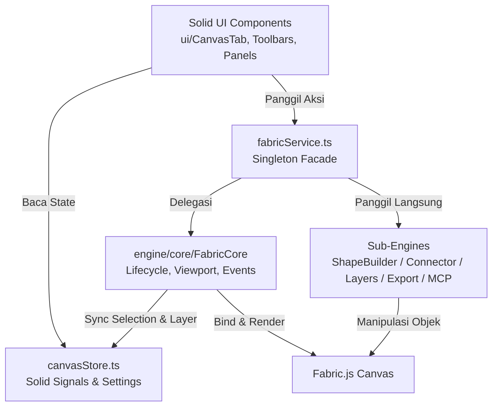

# Canvas Architecture & Navigation Map

Panduan peta arsitektur modul Canvas untuk AI dan Developer agar navigasi kode terarah, modular, dan tidak salah sasaran saat modifikasi.

---

## 🧭 Directory Structure

```text
web/src/components/canvas/
├── index.ts                <-- Public re-export (CanvasTab, store, fabricService, types)
├── types.ts                <-- Definisi tipe data domain (CanvasTool, ShapeProps, Layer, MCP types)
├── canvasStore.ts          <-- Reactive State (Solid.js signals: activeTool, colors, layers, zoom)
├── fabricService.ts        <-- Facade Singleton penghubung UI Layer <-> Engine Layer
├── README.md               <-- (Peta ini) Panduan AI & arsitektur navigasi
│
├── ui/                     <-- KELOMPOK UI (Solid.js components)
│   ├── index.ts               (Barrel export seluruh komponen UI)
│   ├── CanvasTab.tsx          (Main tab container, mount & lifecycle canvas element)
│   ├── CanvasToolbar.tsx      (Top/Floating toolbar pilihan tool: select, rect, arrow, pen, dll.)
│   ├── InspectorToolbar.tsx   (Contextual floating toolbar untuk properti objek yang terpilih)
│   ├── LayersPanel.tsx        (Panel hirarki layer: drag reorder, visibility, lock, delete)
│   ├── AiDrawingPanel.tsx     (Panel demo & status eksekusi perintah AI / MCP drawing)
│   ├── ExportModal.tsx        (Dialog modal ekspor PNG / JPG / SVG dengan waypoint-aware bounds)
│   └── ShortcutsModal.tsx     (Daftar contekan shortcut keyboard)
│
└── engine/                 <-- KELOMPOK ENGINE (Fabric.js v6 murni, bebas UI framework)
    ├── index.ts               (Barrel export engine)
    ├── shapeBuilder.ts        (Boolean operations: irisan, pemotongan, peleburan/union poligon)
    ├── connector.ts           (Logika routing garis penghubung pintar & kalkulasi titik anchor)
    ├── portOverlay.ts         (Overlay visual snap-point / port koneksi saat mendekati shape)
    ├── layers.ts              (Operasi manipulasi z-order, grouping, lock, and visibility)
    ├── export.ts              (Logika ekspor gambar bitmap & SVG dengan waypoint-aware crop)
    ├── mcp.ts                 (Runner eksekusi aksi drawing AI / Model Context Protocol)
    │
    ├── objects/               (Factory modular objek: rect, circle, line, connector, text)
    ├── core/                  (Core lifecycle Fabric.js)
    │   ├── index.ts           (Class FabricCore: orchestrator canvas instance)
    │   ├── viewport.ts        (Zooming, panning mouse wheel, space drag)
    │   ├── history.ts         (Undo / Redo state pointer snapshot manager)
    │   ├── clipboard.ts       (Copy, paste, duplicate objek)
    │   └── events/            (Event listener canvas)
    │       ├── index.ts           (Aggregator bindEvents)
    │       ├── creationHandlers.ts (Mouse down/move/up saat membuat shape/garis baru)
    │       ├── objectTransform.ts  (Moving, scaling, rotating + snap to grid)
    │       └── selectionSync.ts    (Sinkronisasi selection canvas ke Solid signals)
    │
    └── drawing/               (Perhitungan geometri & kustomisasi render Fabric)
        ├── index.ts           (Barrel export drawing)
        ├── arrow.ts           (Custom arrow rendering & SVG marker)
        ├── controls.ts        (Custom handles / kontrol titik sudut pada shape)
        ├── endpointControls.ts (Kontrol handle khusus ujung garis / connector)
        ├── strokeAlign.ts     (Penyesuaian stroke inside / outside / center)
        └── helpers.ts         (Snap coordinate calculation & pointer scene coordinates)
```

---

## 🔄 Data Flow & Relasi Komponen



---

## 📌 Aturan Modifikasi Kode untuk AI

1. **Pemisahan Tegas UI vs Engine**:
   - Komponen dalam `ui/` tidak boleh memanggil instance `fabric.Canvas` secara langsung. Selalu gunakan `fabricService`.
2. **State Reaktif**:
   - Semua state disimpan di `canvasStore.ts`. Engine Fabric murni tidak menyimpan state reaktif Solid.
3. **Undo/Redo (History)**:
   - Setiap mutasi objek signifikan pada canvas harus memanggil `history.saveState()` atau melalui `fabricService.saveState()`.
4. **Waypoints & Connector**:
   - Jangan masukkan connector line ke dalam grup `ActiveSelection` statis agar listener `updateConnectedLines` tetap bekerja dinamis saat shape digeser.
5. **Pemisahan `Line` vs `Connector`**:
   - **Line**: Garis lurus biasa (2-titik) dekoratif. Bebas menyeberang atau menembus interior shape apa pun.
   - **Connector**: Garis relasi cerdas (elbow/orthogonal atau curved). Port berlabuh di perimeter luar shape (`top`, `right`, `bottom`, `left`). Dilarang masuk/menembus ke dalam bodi objek (menggunakan deteksi rute obstacle avoidance di luar bounding box).
